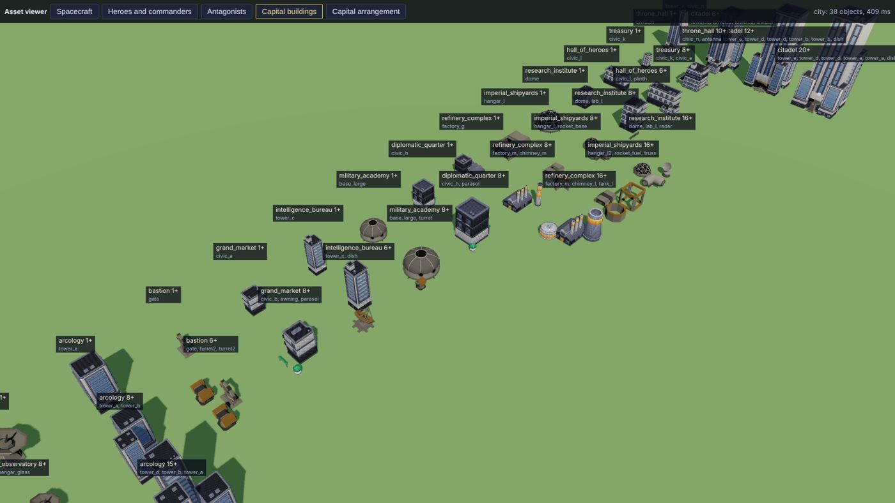
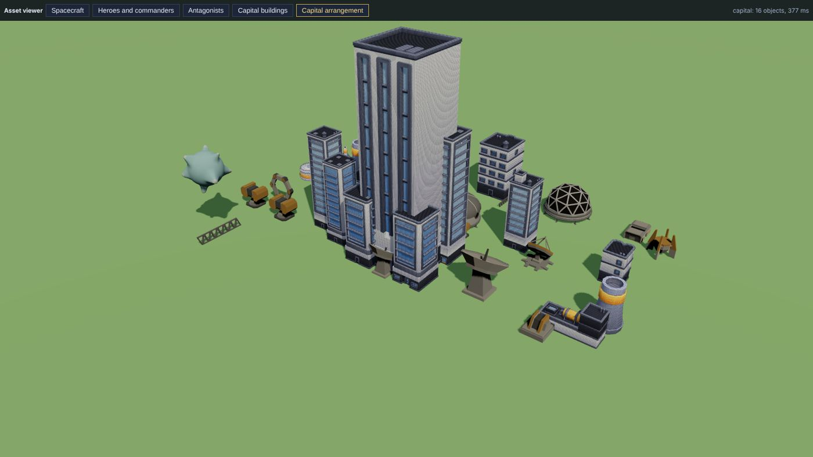
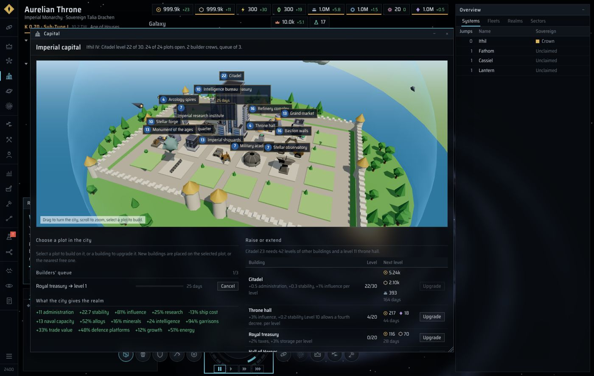
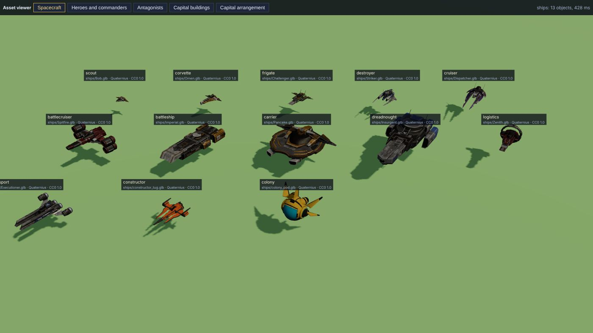
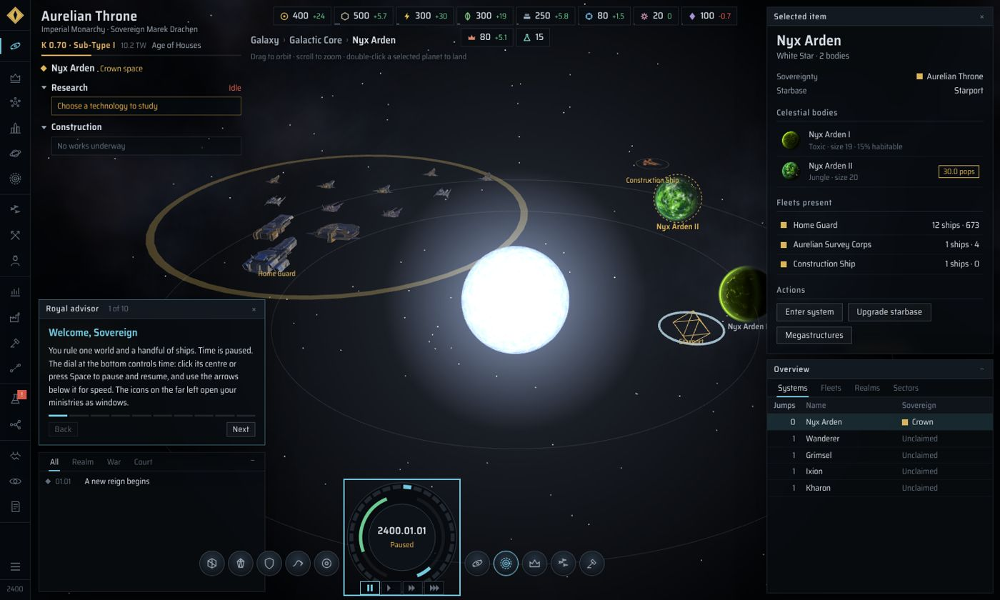
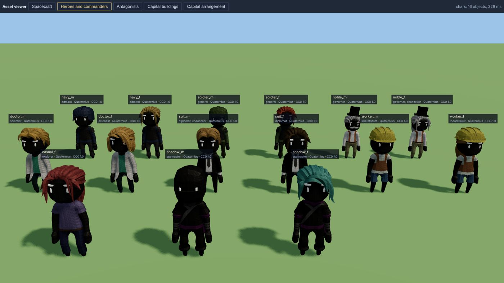
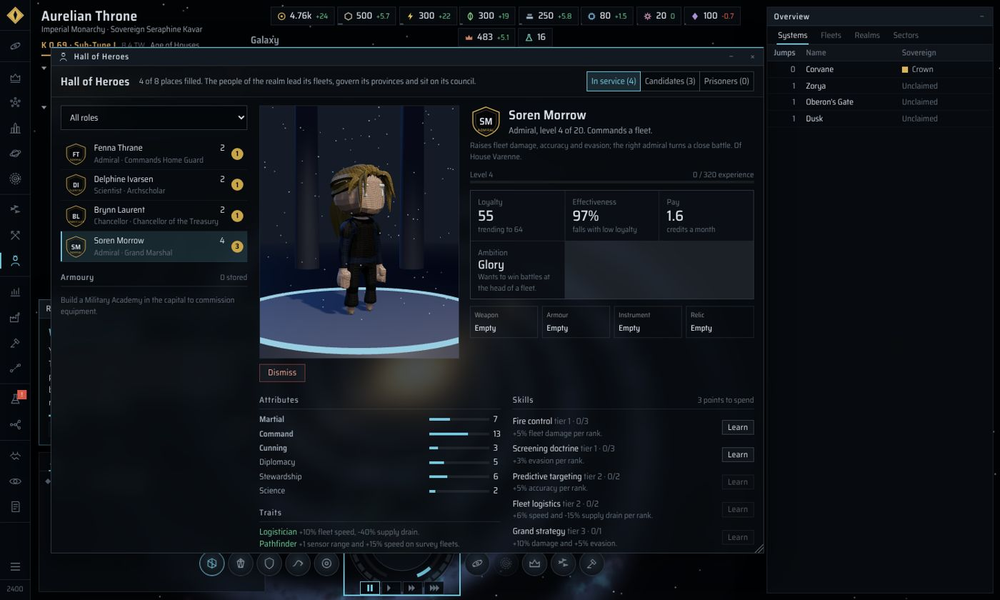
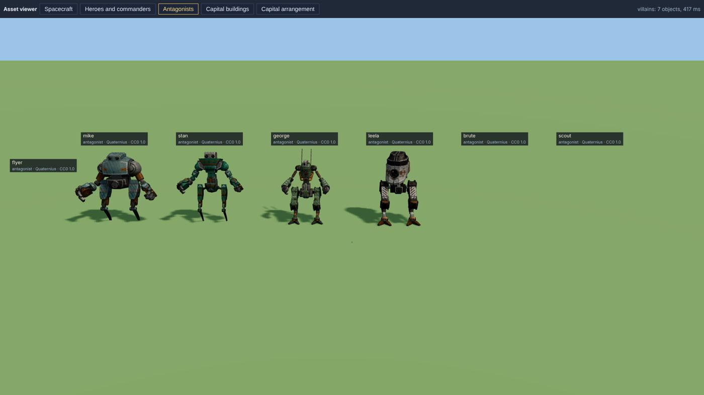

# Asset catalog

> **Status (milestone 11): under visual review.** The models below are the current production set. They work, but the capital, hero and villain looks are **not approved** as the final visual direction. Candidate replacements, live comparison renders and the decisions needed are in [`ASSET_WISHLIST.md`](ASSET_WISHLIST.md). Nothing below will be replaced until a direction is approved.

Every 3D model the game ships with is **CC0 1.0 (public domain)**. No attribution is required, and commercial use, embedding and redistribution are allowed. The game credits each creator anyway, in this file and in the asset viewer.

- **Registry in code:** `src/ui/render/assets/catalog.ts`. Rendering code asks for models by role (ship class, character role, capital building), never by file, so replacing an asset means editing that one file.
- **Model files:** `public/assets/models/{ships,chars,villains,city,space}`, 91 GLB files, 22 MB in total. Textures are embedded and converted to WebP with a 1024 px maximum.
- **Asset viewer:** run `npm run dev`, then open `/assets.html`. It has five tabs: Spacecraft, Heroes and commanders, Antagonists, Capital buildings (every tier) and Capital arrangement.
- **Comparison gallery (development only):** `/compare.html` renders candidate sets beside the production set. Candidate packs are fetched with `npm run candidates:fetch` into `dev-assets/` (gitignored) and never reach the production build.
- **Loading and failures:** `src/ui/render/assets/loader.ts` loads each model once. A failed load is recorded, logged and announced, and the HUD shows a notice naming the missing models. Views free their GPU resources through `releaseView` when they close.
- **Checks:** `tests/assets.test.ts` confirms that every file exists, parses as GLB, embeds its textures and comes from a CC0 pack. It also checks that every ship class, character role and capital building is mapped, and that animated models have an idle clip and opaque materials.
- **Paid assets, or assets that need an account:** see `docs/ASSET_WISHLIST.md`.

## Candidate sources under review (milestone 12)

The capital laboratory evaluates the KayKit Medieval Hexagon Pack (environment pieces only) and KayKit Space Base Bits, both CC0, from the creator's own GitHub repositories. They are fetched into `dev-assets/` for development only. Sources, sizes and renders are in [`CAPITAL_LAB.md`](CAPITAL_LAB.md).

## Sources used

| Pack | Creator | Source | License | Format received | Used for |
|---|---|---|---|---|---|
| Ultimate Spaceships (May 2021), 11 ships | Quaternius | https://opengameart.org/content/lowpoly-spaceships-pack (file `ultimate_spaceships_-_may_2021.zip`, 103 MB) | CC0 1.0 | FBX, OBJ, Blend; colour-variant PNG textures | Military and support ships |
| Ultimate Space Kit, 87 models | Quaternius | https://opengameart.org/content/ultimate-space-kit-by-quaternius (`ultimate_space_kit-glb.zip`, 5.6 MB) | CC0 1.0 | GLB | Colony and construction ships, domes, habitats, radar, globe monument, alien species |
| Ultimate Animated Character Pack (Nov 2019), 52 characters | Quaternius | https://opengameart.org/content/animated-characters-pack (`ultimate_animated_character_pack_by_quaternius.zip`, 48 MB) | CC0 1.0 | FBX (rigged, 11 animations), OBJ, Blend | Heroes and commanders (16 bodies) |
| Animated Mech Pack (March 2021), 4 mechs | Quaternius | https://opengameart.org/content/animated-mech-pack (`animated_mech_pack_-_march_2021.zip`, 26 MB) | CC0 1.0 | FBX (rigged, 18 animations) and textures | Mercenaries and antagonists |
| Space Kit 2.0 | Kenney | https://opengameart.org/content/space-kit-remade (`spacekit_2.0.zip`, 6.7 MB) | CC0 1.0 | GLB, FBX, OBJ | Hangars, satellite dishes, rocket parts, turrets, gates, generators |
| City Kit (Commercial) 2.1 | Kenney | https://opengameart.org/content/city-kit-commercial (`kenney_city-kit-commercial_2.1.zip`) | CC0 1.0 | GLB with an external colour map | Citadel towers, arcologies, civic halls, market |
| City Kit (Industrial) 2.0 | Kenney | https://opengameart.org/content/city-kit-industrial (`kenney_city-kit-industrial_2.0.zip`) | CC0 1.0 | GLB with an external colour map | Refineries, chimneys, tanks, forges |

## Capitals and architecture

Each capital building has **level tiers**. Every tier is a composition of sourced parts, defined in `BUILDING_TIERS`. Within a tier the building grows a little with each level, and at each tier threshold it changes shape: annexes, dishes and towers are added.

| Building | Tiers (from level) | Parts |
|---|---|---|
| Citadel (centrepiece) | 1, 6, 12, 20 | A Kenney skyscraper-e keep. Paired skyscraper-c and skyscraper-d wings rise around it with level, then a crown of skyscraper-a and skyscraper-b towers with a large satellite dish |
| Throne hall | 1, 10 | Kenney civic building-m, then building-n with an antenna |
| Royal treasury | 1, 8 | Kenney building-k, then an annex (building-e) |
| Hall of Heroes | 1, 6 | Kenney building-l, then a memorial plinth (Quaternius) |
| Research institute | 1, 8, 16 | Quaternius geodesic dome, then a lab wing, then roof radar |
| Imperial shipyards | 1, 8, 16 | Kenney hangar, then a rocket base, then a fuelled rocket and truss |
| Refinery complex | 1, 8, 16 | Kenney industrial building-g, then building-m with a chimney, then a large chimney and tank |
| Diplomatic quarter | 1, 8 | Kenney building-h, then a parasol terrace |
| Military academy | 1, 8 | Quaternius large base, then a defence turret |
| Intelligence bureau | 1, 6 | Kenney skyscraper-c, then a satellite dish |
| Grand market | 1, 8 | Kenney building-a, then building-b with awnings and parasols |
| Bastion walls | 1, 6 | Kenney gate complex, then twin turrets |
| Arcology spires | 1, 8, 15 | One, two, then three Kenney skyscrapers |
| Stellar observatory | 1, 8 | Large Kenney dish, then a glass hangar |
| Stellar forge | 1, 8 | Kenney generator and chimney, then industrial building-r |
| Monument of the ages | 1, 5 | Quaternius planet globe on a metal plinth |

Status: **integrated, not approved as final**. The capital view (`src/ui/render/capital3d.ts`) builds every occupied plot from these parts. The earlier procedural models now appear only for the moment before the models load, or if a file fails to load. The plateau, walls, roads, trees, shield dome and sky are still procedural supporting elements.

## Military spacecraft

| Class | Model | Display length | Silhouette |
|---|---|---|---|
| Scout | Quaternius *Bob* | 0.7 | Small, swept wings |
| Corvette | *Omen* | 0.8 | Delta |
| Frigate | *Challenger* | 0.95 | Forward-swept fighter |
| Destroyer | *Striker* | 1.15 | Blade hull |
| Cruiser | *Dispatcher* | 1.45 | Long split hull |
| Battlecruiser | *Spitfire* | 1.7 | Twin engine nacelles |
| Battleship | *Imperial* | 2.1 | Armoured block |
| Carrier | *Pancake* | 2.2 | Wide saucer deck |
| Dreadnought | *Insurgent* | 2.8 | Massive armoured hull |
| Logistics tender | *Zenith* | 1.3 | Ring-mounted tender |
| Troop transport | *Executioner* | 1.2 | Twin-pod lifter |

Each class has a distinct model. None is a rescaled copy of another, and the tests enforce this. Status: **integrated** in the system view, where each fleet is a wedge of its real hulls with the largest ship leading.

## Civilian spacecraft

| Class | Model | Notes |
|---|---|---|
| Construction ship | Quaternius Space Kit *Spaceship* | Stylised, brighter than the military set |
| Colony ship | Quaternius Space Kit *Spaceship (u105)* | Stylised pod |

Gap: no CC0 mining, cargo, science or diplomatic vessels were found in a matching style. The game has no separate classes for these yet, and they are listed in the wishlist.

## Heroes and commanders

| Role | Bodies (male / female) |
|---|---|
| Admiral | BlueSoldier (naval uniform) |
| General | Soldier |
| Governor | OldClassy |
| Scientist | Doctor (young) |
| Diplomat | Suit |
| Chancellor | OldClassy female, Suit male |
| Industrialist | Worker |
| Explorer | Casual / Casual2 |
| Spymaster | Ninja |

All bodies are rigged and carry 11 animations: Idle, Walk, Walk_Carry, Punch, Shoot_OneHanded, RecieveHit, Defeat, Victory, PickUp, SitDown and StandUp. The Hall of Heroes plays Idle on a lit stage. The pack draws skin as a dark silhouette, so the game tints the *Skin* material to a human tone per character.

Status: **integrated, not approved as final**.

Limitation: the bodies have stylised chibi proportions, and the pack's fantasy costumes (knights, vikings, wizards) are deliberately not used. Quaternius's *Universal Base Characters* (CC0, realistic proportions, standard humanoid rig) would be better. Its only download route is itch.io's download page in a browser; automated downloads were refused here. Its skeleton and proportions were verified through the CC0 Universal Animation Library mannequin, which shares them (see the wishlist).

## Villains and antagonists

| Model | Pack | Notes |
|---|---|---|
| Mike, Stan, George, Leela | Quaternius Animated Mech Pack | Rigged, 18 animations, textured. Used for mercenaries and war machines |
| Alien brute, scout, flyer | Quaternius Ultimate Space Kit | Static alien species |

Status: catalogued and shown in the viewer as `ANTAGONIST_MODELS`. The game has no antagonist portrait screen yet, so these are not placed in gameplay views.

## Environment and planetary structures

Planets, stars, nebulae, galaxy, plateau and sky are procedural shaders. They are not replaced, because the procedural planets are part of the 10,000-system generator. Habitat models (Quaternius house pod, cylinder and long house) are catalogued for colony views.

## Supporting assets

Solar arrays, water tower, connector tubes, trusses and the landing pad are catalogued for decoration (`DECOR`) and for future colony and spaceport views.

## Characters (modular human kit)

People in the Hall of Heroes, the throne room and envoy panels are built from Quaternius' free Standard packs, all CC0. `npm run candidates:fetch` downloads them; the itch.io-only packs use the store's own free-download flow.

| Pack | Free Standard contents used |
|---|---|
| Universal Base Characters | 2 bodies (only the head is kept), 5 hairstyles, beard, eyebrows |
| Modular Character Outfits - Fantasy | Ranger and Peasant outfits, male and female, as separate body, arm, leg, feet, hood and pauldron parts |
| Universal Animation Library 1 and 2 | 24 clips: idle, talking, folded arms, formal walk, pistol idle, aim and shoot, sword, command gesture, interact, yes, no, comms, sitting, hit, death |
| Sci-Fi Essentials Kit | pistol and revolver held in the hand |

All the packs share one 65-bone skeleton with identical rest poses, so clips from either library play on any body without retargeting (`tests/human-kit.test.ts` checks this from the files). `scripts/blender/build_characters.py` builds `chars2/male.glb` and `female.glb`, each with every part on one armature, plus `anims.glb` and `props.glb`. `scripts/optimize-glb.mjs` quantizes vertex data and resamples the clips.

Archetypes (`src/ui/render/characters/archetypes.ts`) pick the parts, recolour the outfit textures with a gradient map in the shader (separate cloth and leather palettes), and set skin and hair tones, proportions, a base pose, gestures and a held sidearm. A character's id picks the variant and the person, so saves and ids are unchanged. The dev-only lab is `charlab.html`. Previews: `docs/asset-previews/characters/`.

Limits of the free packs:
- Only two outfit families exist, so uniforms are recoloured Ranger and Peasant parts. There are no long coats, robes or helmets.
- Neither animation library has a salute.
- There are no alien humanoid leaders. Alien realms would need another pack.
- The Source versions, which add more outfits and parts, are paid and were not bought.

## Megastructures (assembled from sourced parts)

The nine megastructure models in `public/assets/models/mega/` are not hand-modelled or generated. `scripts/blender/assemble_megastructures.py` imports downloaded parts, trims them to the pieces wanted, places linked copies and groups them into `stage_<n>` nodes, one per construction stage. Fetch the sources with `npm run candidates:fetch -- q-ultimate-space-kit k-space-kit kaykit-space-base nasa-3d`.

| Part source | Licence | Used for |
|---|---|---|
| Quaternius Ultimate Space Kit | CC0 | transit tubes (ring and gate tori), trusses, habitats, domes, antennas |
| Kenney Space Kit | CC0 | structural frames, turrets, fuel tanks, generators (re-skinned to one hull material) |
| KayKit Space Base Bits | CC0 | tall frames, solar panels, lights |
| NASA 3D Resources | Public domain | Deep Space Network 70 m dish (collector and array), TDRS umbrella antenna (relays, emitters), solar sail (Dyson swarm statites) |

NASA media are not copyrighted. The NASA usage guidelines still apply: the models carry no NASA insignia and imply no endorsement. Textures are reduced to 512 px and the dish is decimated to half its faces, so every model stays under 2 MB. Previews: `docs/asset-previews/m14/`.

| Rejected for megastructures | Reason |
|---|---|
| The earlier procedural kit (`scripts/blender/megastructures.py`) | Primitive geometry, replaced on review |
| ISS and TDRS solar arrays cut out of their spacecraft | The arrays are many loose strips, so extraction left slivers |
| Quaternius Modular Sci-Fi (2021) and MegaKit | Interior pieces |
| OpenGameArt single models (Acharkl station, space port, Bellanger shipyard) | Ground props or very dense meshes |

## Evaluated and rejected

| Asset | Source | Reason |
|---|---|---|
| Alien buildings set and extension pack (rubberduck, CC0) | OpenGameArt | Real geometry and PBR metal textures, but the dark, gritty look clashes with the bright stylised kits |
| Kenney Space Kit *craft_* ships (CC0) | OpenGameArt | Toy-like blocky shapes. They looked weak beside the Quaternius hulls |
| Anaxarch 3D Space Ship Pack (CC0) | OpenGameArt | Untextured white meshes |
| Quaternius Modular Sci-Fi MegaKit (CC0) | OpenGameArt | Interior corridor pieces at room scale, not exteriors |
| Kenney Building Kit and Tower Defense Kit (CC0) | OpenGameArt | Wall fragments, and a fantasy tower style |
| Quaternius packs on quaternius.com | Google Drive | Drive refuses downloads from this environment ("quota exceeded"). The same packs were taken from the OpenGameArt mirrors |
| Kenney.nl and Poly Pizza | Their own sites | Blocked by the network proxy. Kenney kits were taken from OpenGameArt |

## Conversion pipeline

1. **Ships:** Blender 4.2 imports the FBX, binds the pack's own colour texture, centres the model, normalises its longest side to 1, and exports GLB.
2. **Characters:** Blender imports the FBX with its armature, removes stray helper meshes, forces opaque materials, puts each animation on its own NLA track, normalises height to 1.8 m, and exports GLB with every clip.
3. **Kenney city GLBs:** glTF-Transform `copy` from the source folder embeds the external colour map.
4. **Everything:** glTF-Transform `resize` (1024 px), `webp`, `dedup` and `prune`, plus `resample` for animations.

The original downloads are not committed. Only the optimised GLBs are.

## Audio

Sound effects are Kenney's CC0 Interface Sounds and Sci-fi Sounds, processed by `scripts/build_audio.py`. Music and synthesised ambience are original and generated at runtime. `docs/AUDIO.md` lists every sound with its source file and licence, and `src/audio/manifest.json` is the machine-readable manifest.

## Capital megacity kit (laboratory variant D, awaiting approval)

`public/assets/models/megacity/kit.glb` (2.1 MB) holds 28 models assembled by `scripts/blender/assemble_megacity.py`. Nothing in it is modelled from scratch: the script appends or imports parts, places them and groups them.

| Source | Creator | Licence | Used for |
|---|---|---|---|
| [Alien building/base set](https://opengameart.org/content/alien-buildingbase-set) and [extension pack](https://opengameart.org/content/alien-builings-extension-pack) | rubberduck | CC0 1.0 | Citadel fortress, drums, blocks, halls, towers, pylons, generator, pipes, walls, gate, corridors (sky-bridges and transit tubes), landing pad. Lime accents recoloured to imperial gold |
| [Industrial extension pack 1: tanks](https://opengameart.org/content/industrial-extension-pack-1-tanks) | rubberduck | CC0 1.0 | Storage tanks (painted textures are not included in the pack, so they are given a steel finish) |
| [Industrial extension pack 3: chimneys](https://opengameart.org/content/industrial-extension-pack-3-factory-chimneys) | rubberduck | CC0 1.0 | Chimneys (concrete finish) |
| Modular Sci-Fi MegaKit (Standard) | Quaternius | CC0 1.0 | Hollow structural cores, truss columns (reduced to 30% of their faces), round floor slabs |
| City Kit Roads | Kenney | CC0 1.0 | Street lamps |
