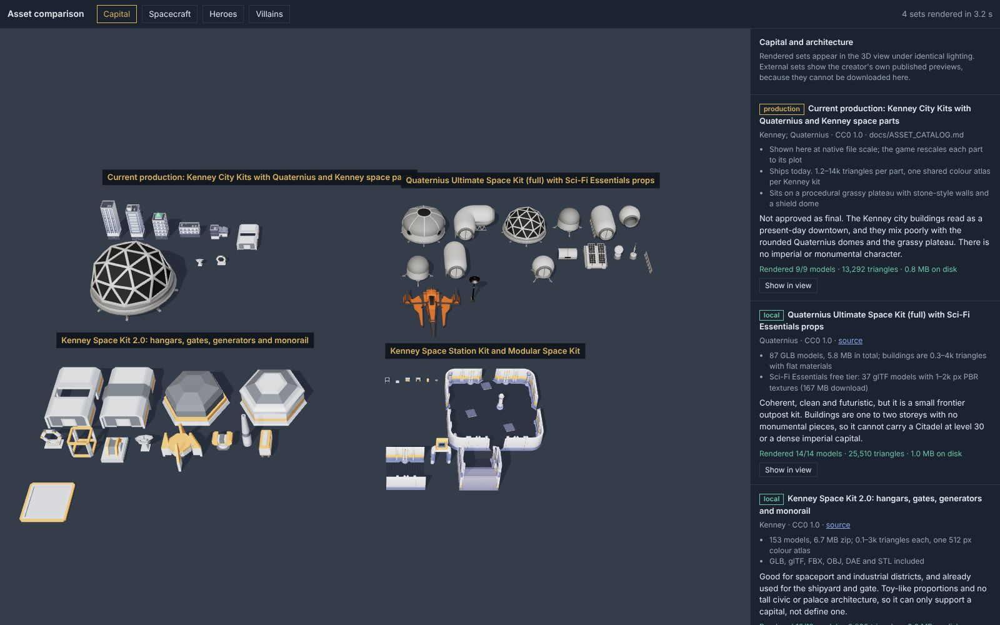
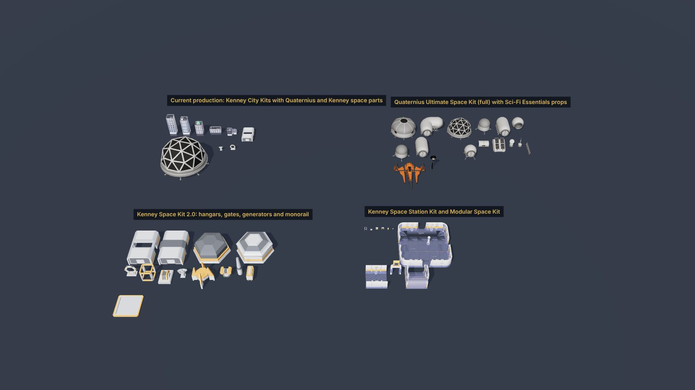
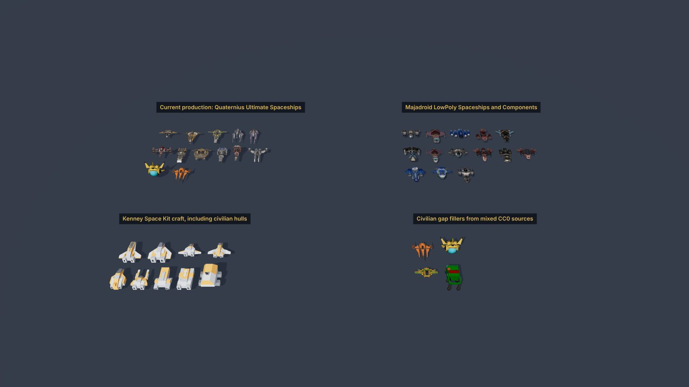
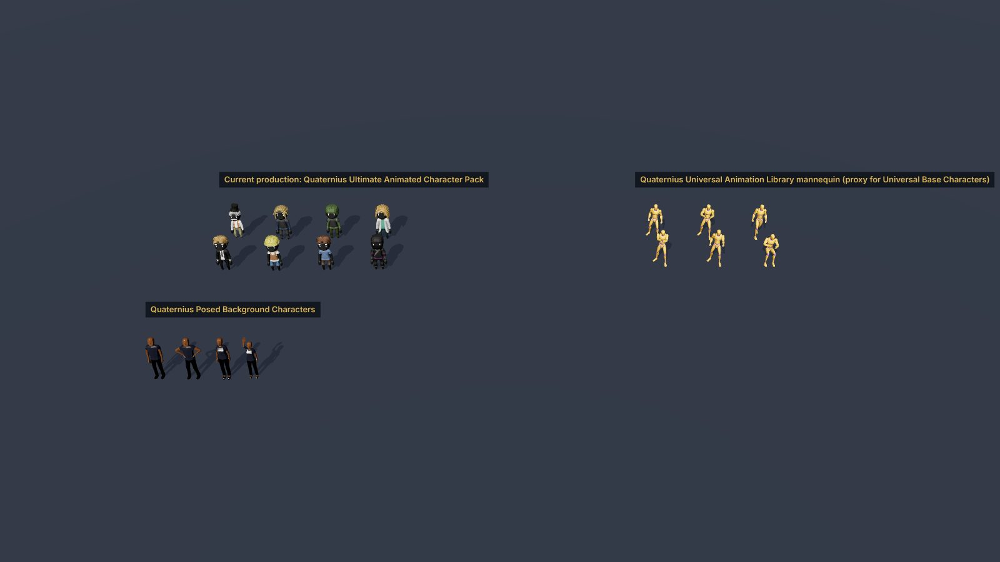
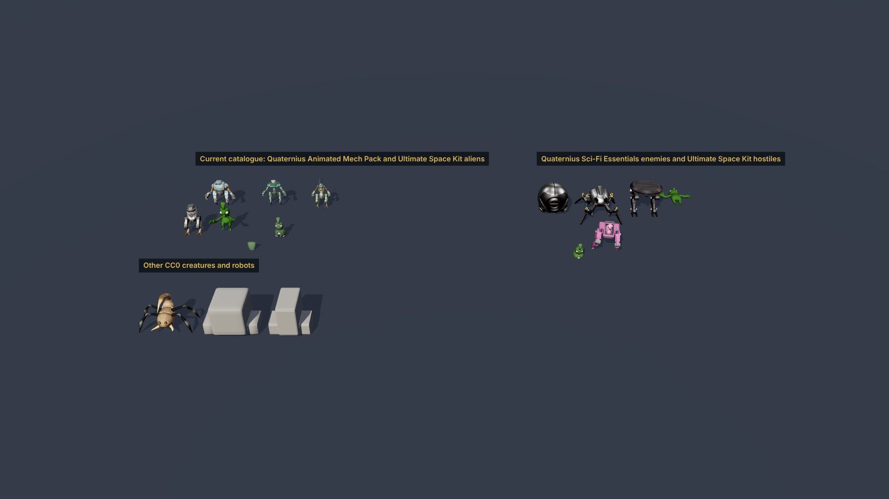

# Asset review and wishlist (milestone 11)

This is the decision document for the game's visual identity. **Nothing here has been bought, and no production asset has been replaced.** The current models stay in the game until you approve a direction.

## How the review was done

- **Sources searched:**
  - OpenGameArt: full CC0 3D search, plus every Quaternius and Kenney upload.
  - itch.io: the Quaternius and KayKit catalogues.
  - Sketchfab: public API search for downloadable CC0 and CC BY models, across 28 queries in four categories.
  - Fab: public listing search for city, fleet, character, alien and mech sets.
  - Also checked: Poly Haven, ambientCG, CGTrader and quaternius.com.
- **Unreachable from this environment:** TurboSquid, Kenney.nl, Poly Pizza and free3d.com (the network proxy returns 403). Downloads from Google Drive and itch.io were refused. Kenney packs were taken from their OpenGameArt mirrors instead.
- **Sets, not single models.** Every candidate was judged as a coherent set that could cover a whole category, not as an isolated model.
- **Live renders where possible.** Every CC0 pack with a public download was rendered in the game's own Three.js engine, under identical lighting, in the development comparison gallery (`/compare.html`). For each model the gallery reports its triangle, texture and animation counts and its size on disk.
- **External previews where not.** Sets that cannot be downloaded here (account, manual download or purchase) are shown in the gallery with the creator's own published preview images, labelled as such. They are linked from this file, not committed.
- **Verified facts.** For external sets, the creator, licence label, delivery formats, mesh count and price come from each marketplace's own listing data. Polygon counts are given only where the creator publishes them. Texture quality and rig quality of paid sets cannot be checked without buying them.

How to reproduce the comparison:

```bash
npm run candidates:fetch     # downloads ~230 MB of CC0 packs into dev-assets/ (gitignored)
npm run dev                  # then open /compare.html
npm run candidates:capture   # re-renders docs/asset-previews/m11/*.jpg (dev server must be running)
```



## Findings by category

### Capital



| Set | Status | Licence | Verified facts | Verdict |
|---|---|---|---|---|
| Current: Kenney City Kits, Quaternius and Kenney space parts ([render](asset-previews/m11/set-capital-production.jpg)) | In production | CC0 | 1.2–14k triangles per part, one atlas per kit | **Not approved.** It reads as a present-day downtown on a grassy plateau. The parts mix poorly, and nothing is monumental or imperial |
| [Quaternius Ultimate Space Kit](https://opengameart.org/content/ultimate-space-kit-by-quaternius) and Sci-Fi Essentials ([render](asset-previews/m11/set-capital-q-space-colony.jpg)) | Rendered | CC0 | 87 models, 5.8 MB; buildings 0.3–4k triangles | Coherent and futuristic, but a small frontier outpost of one- and two-storey domes. It cannot carry a level-30 Citadel |
| [Kenney Space Kit 2.0](https://opengameart.org/content/space-kit-remade) ([render](asset-previews/m11/set-capital-k-space-base.jpg)) | Rendered | CC0 | 153 models, 0.1–3k triangles, 512 px atlas | Good spaceport and industrial pieces. Toy proportions, and no civic or palace architecture |
| [Kenney Space Station Kit](https://opengameart.org/content/space-station-kit) and [Modular Space Kit](https://opengameart.org/content/modular-space-kit) ([render](asset-previews/m11/set-capital-k-station.jpg)) | Rendered | CC0 | 137 interior pieces | **Rejected** for exteriors. These are interior kits; they could later serve a throne-room or council-chamber interior |
| [Quaternius Downtown City MegaKit](https://quaternius.itch.io/downtown-city-megakit) | External (itch.io) | CC0 | Free tier, 223 MB | Polished, but present-day. Same problem as the current buildings |
| [KayKit Space Base Bits](https://kaylousberg.itch.io/space-base-bits) | External (itch.io) | CC0 | 48+ models, 1024 px atlas, 5.2 MB | Mining-colony toy style. Suits colony worlds, too small for a capital |
| [Low Poly Flying Sci Fi Island City](https://www.fab.com/listings/81e34e7d-d23a-43c3-a9e0-b44265a21d3f), Mnostva Art | External (Fab, free) | Fab Standard | 53 meshes; GLB, FBX, OBJ and Blender | **Best free lead.** A floating futuristic city in a stylised low-poly look that matches the ships. Needs a Fab account |
| [Low Poly Sci-Fi Planet Base](https://www.fab.com/listings/6c0316ae-9192-4c09-a461-7593cef4ee41), JustCreate | External (Fab) | Fab Standard | 211 meshes; GLB and FBX; $49.99 | Affordable and web-ready, with a planetary-capital feel. Less monumental |
| [Synty POLYGON Sci-Fi Cyber City](https://www.fab.com/listings/e655357b-8b7b-41b8-9d36-13622ac3b00a) / [Sci-Fi Worlds](https://www.fab.com/listings/dad680a5-fcaf-4863-b080-f9b4fdc2ac5e) | External (Fab or Synty) | Synty EULA / Fab Standard | 926 / 1,285 meshes; $199.99 / $499.99; Fab copies are Unreal-only | **The most coherent complete option:** one style across city, ships, characters, aliens and mechs |
| Sketchfab CC BY singles (Simple Dome by nenkea, Sci-Fi Tower by Jonathan, Futuristic City Chunk by LxNazarov) | External (Sketchfab) | CC BY 4.0 | 3.4k–120k faces | Attractive individually, but by different artists with different styles. Not a coherent capital |

**Finding:** no reachable CC0 source provides monumental, futuristic, imperial exterior architecture. Every CC0 option is a small outpost kit, an interior kit or a present-day city. A Citadel that grows impressively to level 30 needs either a commercial kit or bespoke art.

### Spacecraft



| Set | Status | Licence | Verified facts | Verdict |
|---|---|---|---|---|
| Current: [Quaternius Ultimate Spaceships](https://opengameart.org/content/lowpoly-spaceships-pack) ([render](asset-previews/m11/set-ships-production.jpg)) | In production | CC0 | 11 hulls, 1–6k triangles, 1024 px textures | The most coherent CC0 fleet found, and readable. **Weaknesses:** every hull is fighter-sized, so the battleship and dreadnought don't read as capital ships, and the colony and construction ships clash in style |
| [Majadroid LowPoly Spaceships](https://opengameart.org/content/3d-lowpoly-spaceships-and-components) ([render](asset-previews/m11/set-ships-majadroid.jpg)) | Rendered | CC0 | 14 ready hulls plus kitbash components; flat colours | All fighter-scale. Building capital ships from the parts would be design work, which needs your approval first |
| [Kenney Space Kit craft](https://opengameart.org/content/space-kit-remade) ([render](asset-previews/m11/set-ships-kenney-craft.jpg)) | Rendered | CC0 | 0.3–1.5k triangles; includes a miner and two cargo hulls | Blocky; rejected for warships. The **only CC0 mining and cargo hulls** found |
| Civilian gap fillers: Ultimate Space Kit ships and g2od cargo ([render](asset-previews/m11/set-ships-civilian-mixed.jpg)) | Rendered | CC0 | 1–2k triangles | Three different styles. Fills the gap in name only |
| [Synty POLYGON Sci-Fi Space](https://www.fab.com/listings/85cfe617-0c52-4dec-857d-43e786a80c2e) | External | Synty / Fab Standard | 602 meshes; $149.99 | Capital-scale hulls plus civilian craft, in the Synty style |
| [Ebal Studios Hi-Rez Spaceships Creator](https://www.fab.com/listings/730d24f1-4622-4625-8791-1f8b2d0b4ca5) | External | Fab Standard | 134 meshes; Blender, FBX, OBJ; $99.99 | Modular parts for a whole fleet in one look, delivered in web-friendly formats |
| [Stellar Armada](https://www.fab.com/listings/030838a9-26f1-48b2-a3dd-e3e9d33a534d), Ultima Store | External | Fab Standard | 32 meshes; Unreal only; $49.99 | Realistic PBR with distinct silhouettes. Would clash with stylised characters, and Unreal-only delivery needs conversion |
| Sketchfab CC BY singles (Luminaris, Space Battleship Aquamarine, SPACESHIP - CARGO, Heavy VTOL gunship) | External | CC BY 4.0 | 4k–113k faces | Mismatched styles and polygon budgets. Franchise fan-art and AI-generated models were excluded |

**Civilian ships.** Mining and cargo exist only in the Kenney style. Science and diplomatic vessels were not found in any CC0 set. The commercial fleet kits (Synty, Ebal) include civilian hulls.

### Heroes and commanders



| Set | Status | Licence | Verified facts | Verdict |
|---|---|---|---|---|
| Current: [Quaternius Ultimate Animated Character Pack](https://opengameart.org/content/animated-characters-pack) ([render](asset-previews/m11/set-heroes-production.jpg)) | In production | CC0 | Rigged, 11 animations, 2–4k triangles | **Not approved.** Chibi proportions and present-day costumes. The game tints the skin, so the black faces in the gallery render are untinted |
| [Universal Animation Library](https://opengameart.org/content/universal-animation-library) mannequin ([render](asset-previews/m11/set-heroes-ual-mannequin.jpg)) | Rendered | CC0 | 13.7k triangles, standard humanoid skeleton, **46 animations** (formal walk, talking, sitting and talking, pistol, interact) | Shows the realistic proportions and the animation set rulers and commanders need. The mannequin itself is a stand-in, not presentable |
| [Quaternius Universal Base Characters](https://quaternius.itch.io/universal-base-characters) | External (itch.io) | CC0 | Free tier, 122 MB; same skeleton as the library above | **Recommended CC0 route.** Realistic proportions, in the same style family as the ships. Outfits are limited: the companion outfit pack is fantasy-themed |
| [Quaternius Posed Background Characters](https://opengameart.org/content/lowpoly-posed-humans) ([render](asset-previews/m11/set-heroes-q-posed.jpg)) | Rendered | CC0 | Static, not rigged | Rejected; crowds at best |
| [Synty Sci-Fi Civilians (Sidekick)](https://www.fab.com/listings/ec421d4d-0764-4895-98f6-9cccd7b04a1c) | External | Synty / Fab Standard | Modular heads, outfits and equipment; $199.99 | The **best outfit and equipment variety** found (officers, civilians, armour) |
| [JustCreate Stylized Modular Sci-Fi Characters](https://www.fab.com/listings/c1c622b5-b461-454d-8180-be6ce01c7689) | External | Fab Standard | FBX; $49.99 | Lower-cost pairing with the JustCreate capital |
| Sketchfab CC BY (Sci-Fi Soldier by ART_LOLL, Sci-Fi Female Warrior by liamoliphant) | External | CC BY 4.0 | About 31k faces, not rigged | Would need rigging, and still wouldn't match each other |

### Villains and antagonists



| Set | Status | Licence | Verified facts | Verdict |
|---|---|---|---|---|
| Current: Quaternius Animated Mech Pack and Ultimate Space Kit aliens ([render](asset-previews/m11/set-villains-production.jpg)) | Catalogued, **not used in gameplay** | CC0 | Mechs rigged with 18 animations; aliens static | The mechs are good mechanical antagonists. The aliens are cute critters, not leaders |
| [Quaternius Sci-Fi Essentials](https://opengameart.org/content/sci-fi-essentials-kit) enemies and Ultimate Space Kit hostiles ([render](asset-previews/m11/set-villains-q-scifi.jpg)) | Rendered | CC0 | Essentials enemies have PBR textures (animated only in the paid Pro tier) | Good rank-and-file threats in the same style family. Still no leader figures |
| cdmir alien bug and pixelmannen robots ([render](asset-previews/m11/set-villains-misc.jpg)) | Rendered | CC0 | The robots' Collada files don't resolve their textures, so they render untextured | Rejected; styles don't match |
| [Synty POLYGON Mech Pack](https://www.fab.com/listings/c1f623be-f74f-46d8-809c-1b5566e6c6db) (+ Sci-Fi Worlds aliens) | External | Synty / Fab Standard | 162 meshes; $99.99 | Fits the Synty route, including alien characters that could serve as rival sovereigns |
| [Alien Character](https://www.fab.com/listings/39c1d5ef-2fb4-4f1d-afbd-20d958189ef4) by Luci3D (free) and [Alien Warrior 01](https://www.fab.com/listings/8359b3d1-8f84-4e43-91d9-31b021ba7823) by Bugrimov Maksim | External | Fab Standard | Alien Warrior: 134k triangles with 4K textures | Realistic sculpts; too heavy and wrong style for a stylised game |
| Sketchfab CC BY creatures by DM-913 (Insectoid Monster Rig, Umbra Marauder Rig), Alien RIG by 3DMAN, Lurker by MooKorea | External | CC BY 4.0 | 4k–110k faces, rigged, 1–8 animations | Distinctive creature antagonists, mostly by one artist. Could form a hostile alien faction if in-game attribution is acceptable |

**Finding:** no CC0 set contains rival sovereigns or alien leaders with presence. That role needs a commercial character set (Synty Sci-Fi Worlds) or commissioned art.

## Recommendation

Three coherent directions. You choose; I won't start production art until you do.

### Direction A: CC0 Quaternius family (no cost)

- **Heroes:** Universal Base Characters, animated with the Universal Animation Library. Both are CC0 and use the same skeleton, already verified above.
- **Ships:** keep Ultimate Spaceships for warships. Use the Kenney miner and cargo hulls only if the style mix is acceptable.
- **Villains:** use the Animated Mech Pack for war machines and the Sci-Fi Essentials enemies for hostile fauna.
- **Capital:** Ultimate Space Kit and Kenney Space Kit for districts. Use the free Fab *Low Poly Flying Sci Fi Island City* as the monumental core, if you get it with a Fab account.
- **What you need to do:**
  - one manual browser download from itch.io (Universal Base Characters, free);
  - optionally, one free Fab download.
- **Remaining gaps:**
  - capital ships still look small;
  - no science or diplomatic vessels;
  - no alien leaders;
  - the capital stays modest.

### Direction B: Synty POLYGON Sci-Fi (most coherent, highest cost)

- **What it is:** Sci-Fi Worlds ($499.99), or individual packs: Cyber City $199.99, Space $149.99, Sidekick Sci-Fi Civilians $199.99, Mech Pack $99.99.
- **Covers:** every category in one art style, including capital-scale ships, civilian craft, modular officers and alien characters.
- **Before buying:**
  - Fab copies are Unreal-only, so buy from Synty's own store for FBX source.
  - Confirm that their licence allows the models to be served as GLB files to web players.

### Direction C: Web-ready mid-price mix (about $200)

- **What it is:**
  - JustCreate Planet Base ($49.99, GLB);
  - JustCreate Stylized Modular Sci-Fi Characters ($49.99);
  - Ebal Hi-Rez Spaceships Creator ($99.99, Blender/FBX/OBJ).
- **Strengths:** the capital and characters share a creator, and every pack ships in formats the pipeline already handles.

**My recommendation: start with Direction A for heroes now and decide between B and C for the capital.**
- **Heroes:** moving from chibi to realistic proportions is the largest visible improvement, and it costs nothing.
- **Capital:** no CC0 option solves it, and it is the category the brief cares most about.
- **Ships:** keep the current fleet until the capital direction is chosen, so all three end up matching.

## Decisions needed from you

1. Which direction (A, B, C, or a mix) to move into production.
2. For Direction A: download **Universal Base Characters [Standard]** (free) from https://quaternius.itch.io/universal-base-characters in a browser and add the zip to the repository, or tell me where it is. Optionally, do the same for the free Fab island city.
3. For B or C: a budget, and your acceptance of the licence terms. Fab's Standard License and Synty's EULA allow assets inside a game but forbid redistributing them as standalone files. A web build necessarily serves model files to the browser, so read those terms (or have someone qualified read them) before purchase. I am not giving legal advice.
4. Whether in-game attribution for CC BY models (the Sketchfab creatures) is acceptable.

## Earlier wishlist entries, now resolved

- **Universal Animation Library:** downloaded and verified (CC0, 46 animations), and rendered in the gallery.
- **Ultimate Modular Men/Women and Sci-Fi Essentials:** Sci-Fi Essentials was obtained from OpenGameArt and rendered. The Modular Men/Women packs are hosted only on Google Drive, which refuses downloads here.
