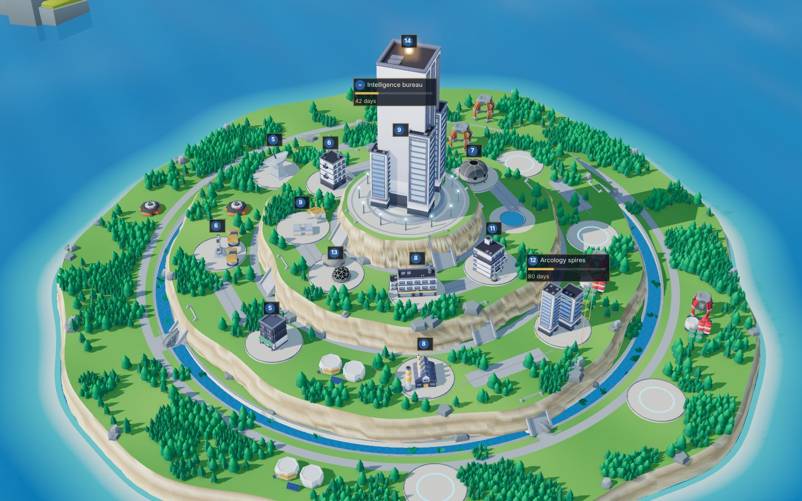
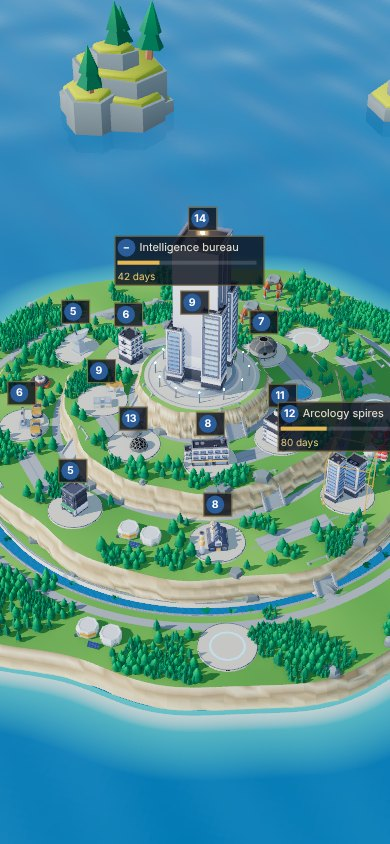
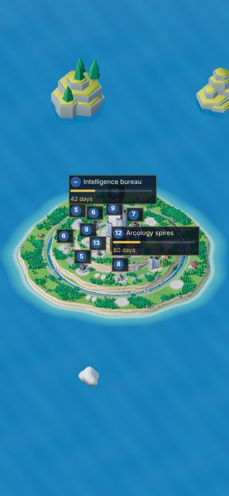
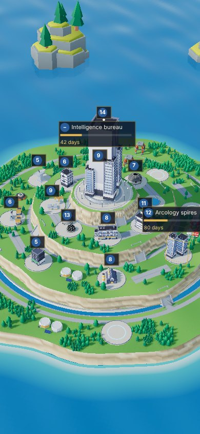
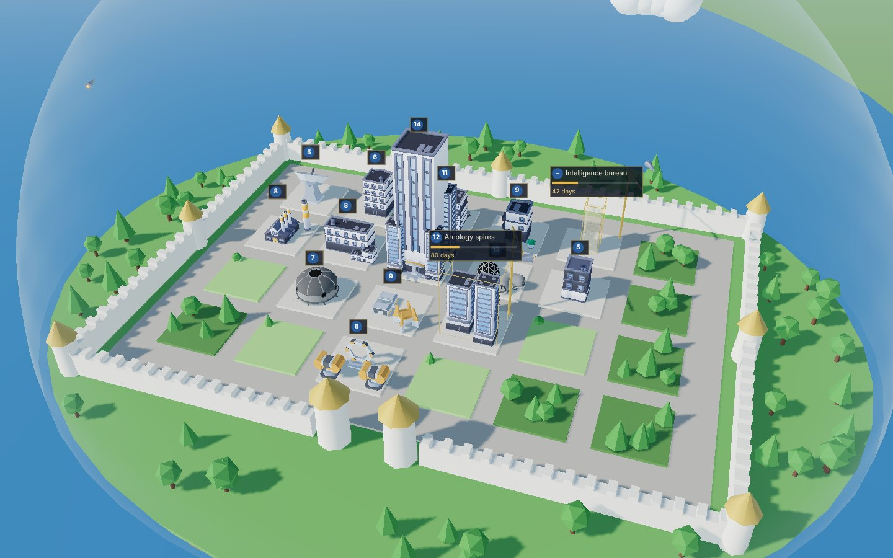

# Capital laboratory (milestone 12)

> **Status: at the visual approval gate.** The production capital is unchanged. Variants B and C exist only in the development laboratory until you approve a direction.

The laboratory renders **the same sample capital** (Citadel level 14, twelve finished buildings, one upgrade and one new building under construction, 18 open plots) **from the same camera angle** in three variants:

| Variant | What it is |
|---|---|
| **A · Current** | The production capital (`src/ui/render/capital3d.ts`), untouched |
| **B · New lighting** | The same production scene and models through the new rendering pipeline |
| **C · Diorama** | A new terraced island built around the same plots, with a free CC0 environment |

```bash
npm run candidates:fetch   # clones the two KayKit packs (CC0) into dev-assets/ (gitignored)
npm run dev                # then open /capitallab.html (live) or /capitallab.html?gallery=1 (screenshots)
npm run lab:capture -- http://localhost:5173 --perf   # regenerate screenshots and measurements
```

The live lab has buttons for each variant, a quality-tier selector (desktop, medium, mobile) and a projection selector (perspective, orthographic). It also shows FPS, draw calls and triangles. To measure a real phone, run `npm run dev -- --host` and open the printed network address on the phone.

## Rendered comparison

The same capital, same angle, captured headlessly at 1440×900 and 390×844.

| | Desktop 1440×900 | Phone 390×844 |
|---|---|---|
| **A · Current** |  |  |
| **B · New lighting** |  |  |
| **C · Diorama** |  |  |
| **C · Orthographic** |  |  |
| **C · Mobile tier** |  |  |
| **B · Mobile tier** |  |  |

## What changed in C (the diorama)

- **Terrain:** an irregular raised island with four terraces at different heights: the Citadel plateau, then upper, middle and outer terraces. The cliff walls between them have layered rock strata and ledges, and the outer cliffs drop to a sandy waterline.
- **Water:**
  - the sea, with a procedural ripple normal map and sky reflections;
  - turquoise shallows and a foam line along the coast;
  - a stone-lined canal ringing the outer terrace.
- **Layout:**
  - **Plaza and Citadel:** a circular paved plaza with a stepped podium, where the Citadel stands as the tallest landmark.
  - **Avenues:** four radial avenues run from the plaza, with ramps down each cliff and bridges over the canal.
  - **Promenades:** ring promenades on each terrace.
  - **Memorial:** a reflecting-pool memorial in the one spare upper-terrace place.
- **Districts:** sci-fi dressing in the gaps between plots, from KayKit Space Base Bits:
  - **residential:** habitat modules and solar panels;
  - **industrial:** cargo depots, containers and drills;
  - **military:** landing pads and landers;
  - **research:** wind turbines and solar arrays.
- **Vegetation:** groves, single trees, rocks on the cliff lips, and water plants in the canal. Locked plots grow woodland, which clears when a plot opens.
- **Background:** distant mountain islets and low clouds.
- **Plots:** round paved pads with a metal rim. Empty open plots show a faint holographic ring.
- **What stays the same:** the building models are the existing catalogue parts, so they still grow by level tier. The grid of square plots is gone.

**Gameplay is preserved:**
- **Plot IDs:** the simulation's 24 plot IDs are kept. `dioramaLayout()` places them on terraces in unlock order (`PLOT_ORDER`), so unlocking still moves outward from the Citadel. No simulation code changed, so saves are unaffected.
- **Same interface:** `DioramaCapitalView3D` has the same interface as the production view (`sync`, `pick`, `plotScreen`, `dispose`). Selection, labels, construction scaffolding and the queue work the same way.
- **Tests:**
  - `tests/diorama-layout.test.ts` checks that every plot is placed once, the Citadel is central, unlock order only moves outward, and every pad lies on its terrace, clear of the avenues, the canal and the other pads.
  - `tests/e2e/capital-lab.spec.ts` checks that clicking a label or the 3D scene selects the right plot.

## Rendering pipeline (`src/ui/render/pipeline.ts`)

Used by B and C. It runs on the project's three.js r160.

| Part | Implementation |
|---|---|
| Composer | `EffectComposer` into a half-float (HDR) render target, with MSAA on desktop and medium, then `RenderPass`, `GTAOPass`, `UnrealBloomPass` and `OutputPass` |
| Ambient occlusion | `GTAOPass` for contact shading. Water and transparent overlays are left out of its depth pass; otherwise the flat sea meeting the cliffs reads as a deep crease and draws a dark ring round the coast |
| Environment | HDR `Sky` pre-filtered with `PMREMGenerator` into `scene.environment`, so PBR materials get matching reflections and ambient light. The visible sky is the same shader |
| Sun and fill | A `DirectionalLight` sun, from the front-left so shadows fall visibly to the right, plus a low `HemisphereLight` fill |
| Shadows | Orthographic shadow camera fitted to the scene bounds in light space. `normalBias` comes from the shadow-texel size and `bias` is small. Map size depends on the quality tier |
| Colour | ACES filmic tone mapping and sRGB output in `OutputPass`, from the renderer settings; exposure 0.82 |
| Bloom | Threshold 4.5 in linear HDR, above any sunlit surface, so only the emissive sci-fi lights bloom (plaza pylons and the Citadel beacon). Off on mobile |
| Not used | No depth of field, motion blur or film grain |

### Quality tiers

| Tier | Pixel ratio cap | MSAA | Shadow map | AO samples / denoise / resolution | Bloom | Vegetation |
|---|---|---|---|---|---|---|
| Desktop | 2 | 4× | 4096 | 16 / 16 / full | Yes | Full density; casts shadows and receives AO |
| Medium | 1.5 | 2× | 2048 | 12 / 8 / 75% | Yes | 75% density; casts shadows, no AO |
| Mobile | 1 | Off | 1024 (PCF) | 8 / 4 / 50% | No | 50% density, lighter tree models only, no shadows or AO |

`detectTier()` picks a tier from touch support, screen size, core count and device memory. The laboratory lets you override it.

## Performance

**Scene cost per frame**, at 390×844 and pixel ratio 1. These counters (`renderer.info`, summed over every pass of the frame: shadow map, AO normals, main view and post-processing) are exact.

PERF_COUNTERS

**What reduced the diorama's cost:**
- Repeated vegetation and rocks are `InstancedMesh`es split into four sector chunks with correct bounding spheres, so off-screen chunks are culled.
- Small static procedural meshes (ribbons, ramps, pylons, rings, pads) are merged into one mesh per material.
- The detail layer (rocks and water plants) is hidden beyond a per-tier camera distance.
- On mobile, vegetation is left out of the shadow and AO passes and uses only the lighter tree models.
- Together these brought the mobile tier from 1.23M to 0.43M triangles and from 875 to 393 draw calls.

**Frame times.** The only GPU available here is SwiftShader, a CPU software rasteriser in headless Chromium. Its timings show relative cost between variants. They are not device frame rates.

PERF_TIMES

**Not measured: real-device frame rates.** No Android phone or desktop GPU was available, so I can't claim the 30 FPS mobile and 60 FPS desktop targets are met. Open the live lab on the target devices (it shows FPS and the tier) and choose the default tier from what you see.

**Cleanup.** `RenderPipeline.dispose()` releases:
- the composer and its render targets;
- every pass;
- the PMREM environment and generator;
- the sky;
- the shadow map.

`DioramaCapitalView3D.dispose()` also frees its kit models, instanced meshes and generated textures, and keeps the shared model cache. The browser test checks that after disposal the renderer reports **0 geometries and 0 textures** for both B and C.

## Asset sources and licences

| Pack | Source | Licence | Used |
|---|---|---|---|
| KayKit Medieval Hexagon Pack 1.0, Kay Lousberg | https://github.com/KayKit-Game-Assets/KayKit-Medieval-Hexagon-Pack-1.0 (the creator's own public repository; `LICENSE.txt` states CC0) | CC0 1.0 | Environment only: grove and single trees, rocks, hills, mountains, clouds, water lily, reeds, stone bridge |
| KayKit Space Base Bits 1.0, Kay Lousberg | https://github.com/KayKit-Game-Assets/KayKit-Space-Base-Bits-1.0 (creator's repository, CC0 in `LICENSE.txt`) | CC0 1.0 | District dressing: habitat modules, cargo depots, containers, drill, landing pads, lander, solar panels, wind turbine, mast |

- **Totals:** the 32 models used come to **1.05 MB** of glTF and bin files. Each pack shares one **1024×1024** gradient-atlas PNG (16 KB and 26 KB). Models run from 18 to 1,540 triangles each.
- **Not used, deliberately:** the pack's hexagonal tiles (they would make the island look hex-tiled) and every medieval building, wall and unit.
- **For review:** the canal bridge is a stone arch from the medieval pack. Say whether it fits.
- **Cost:** IDR 0. Nothing was bought, and there are no subscriptions or restricted downloads.
- **Not yet in the repository:** the packs are fetched into `dev-assets/` for the laboratory. If you approve C, the chosen models would be converted to GLB, added under `public/assets/models/`, and listed in `ASSET_CATALOG.md`.

## Direction A: renewed search for character models

- **What I found:** a public CC0 repository that redistributes the Quaternius packs as OpenUSD files: `chibifire-stages/quaternius-stage`. It includes:
  - Universal Base Characters (base bodies, 37 MB);
  - Ultimate Modular Men and Ultimate Modular Women (realistic-proportion outfits, including a King, about 108 MB).
- **Why I didn't download it:** it's a third-party conversion rather than the creator's own release, and this session's safety policy blocked the download as a way around the itch.io restriction.
- **Your options:**
  - approve that mirror as a source;
  - download Universal Base Characters [Standard] from https://quaternius.itch.io/universal-base-characters in a browser and add it to the repository.

  Either way, Blender 4.2 is available here to convert the files to GLB for the Hall of Heroes.

## Known limitations

- **The Citadel** is still the existing Kenney skyscraper composition, scaled up on a podium. It dominates the skyline but isn't yet a distinctive monumental sci-fi landmark. No free model found so far is monumental enough; this is the main art gap left.
- **Labels** are drawn over the scene, as in production, so a plot directly behind the Citadel shows its label over the tower.
- **Mobile frame rate:** the mobile tier's 0.43M triangles per frame should suit mid-range phones, but this hasn't been measured on a device.
- **Visual regression baseline:** the screenshot baseline (`tests/e2e/capital-lab.spec.ts-snapshots/`) was made with headless Chromium on Linux and SwiftShader. Other platforms need their own baseline.

## Decision needed

1. Approve **C** (diorama) for production, approve **B** (new lighting on the current layout), or request changes. Examples: the camera (perspective or orthographic), the terrace heights, vegetation density, the bridge style, the Citadel treatment.
2. Choose the default quality tier per device class, after trying the live lab on your phone.
3. Choose how to get the Direction A character models, as described above.
