# Capital laboratory (milestone 12)

> **Status: at the visual approval gate.** The production capital is unchanged. Variants B and C exist only in the development laboratory until you approve a direction.

The laboratory renders **the same sample capital** (Citadel level 14, twelve finished buildings, one upgrade and one new building under construction, 18 open plots) **from the same camera angle** in three variants:

| Variant | What it is |
|---|---|
| **A · Current** | The production capital (`src/ui/render/capital3d.ts`), untouched |
| **B · New lighting** | The same production scene and models through the new rendering pipeline |
| **C · Diorama** | A new terraced island built around the same plots, with a free CC0 environment |

```bash
npm run candidates:fetch   # clones the two KayKit packs (CC0) into dev-assets/ (gitignored)
npm run dev                # then open /capitallab.html (live) or /capitallab.html?gallery=1 (screenshots)
npm run lab:capture -- http://localhost:5173 --perf   # regenerate screenshots and measurements
```

The live lab has buttons for each variant, a quality-tier selector (desktop, medium, mobile) and a projection selector (perspective, orthographic). It also shows FPS, draw calls and triangles. To measure a real phone, run `npm run dev -- --host` and open the printed network address on the phone.

## Rendered comparison

The same capital, same angle, captured headlessly at 1440×900 and 390×844.

| | Desktop 1440×900 | Phone 390×844 |
|---|---|---|
| **A · Current** | 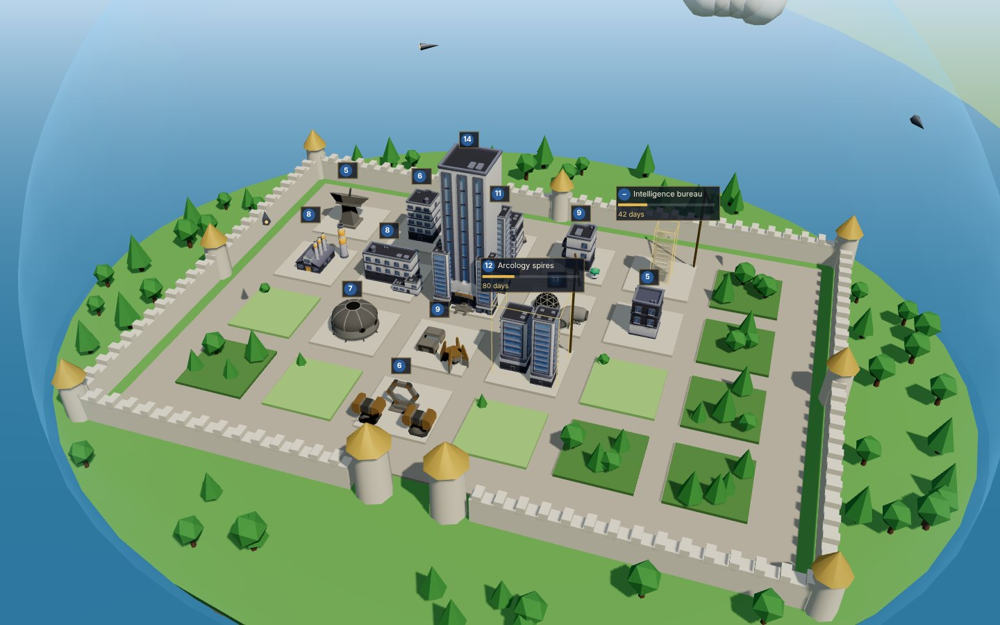 | 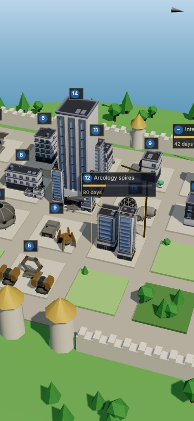 |
| **B · New lighting** |  | 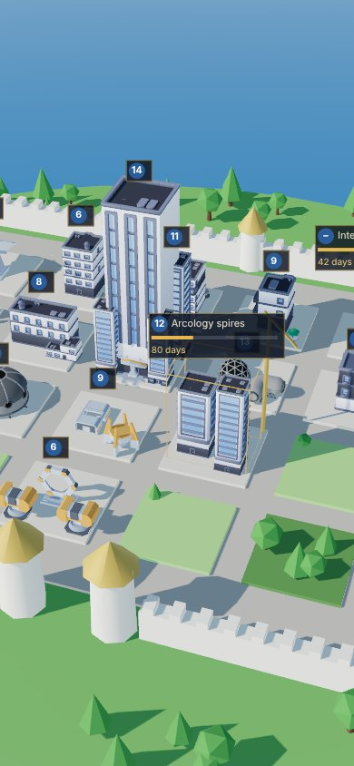 |
| **C · Diorama** |  |  |
| **C · Orthographic** | 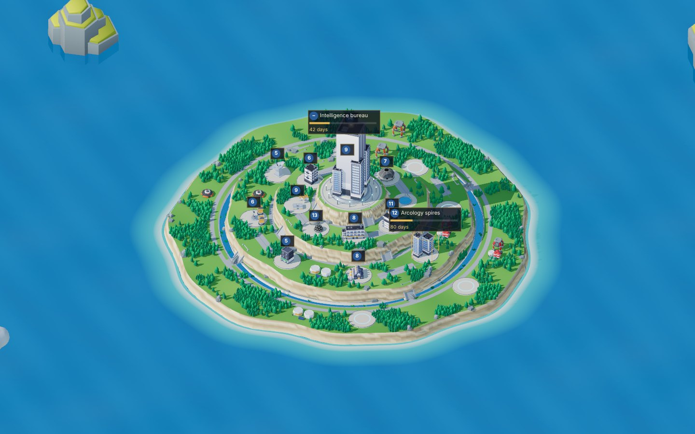 |  |
| **C · Mobile tier** | 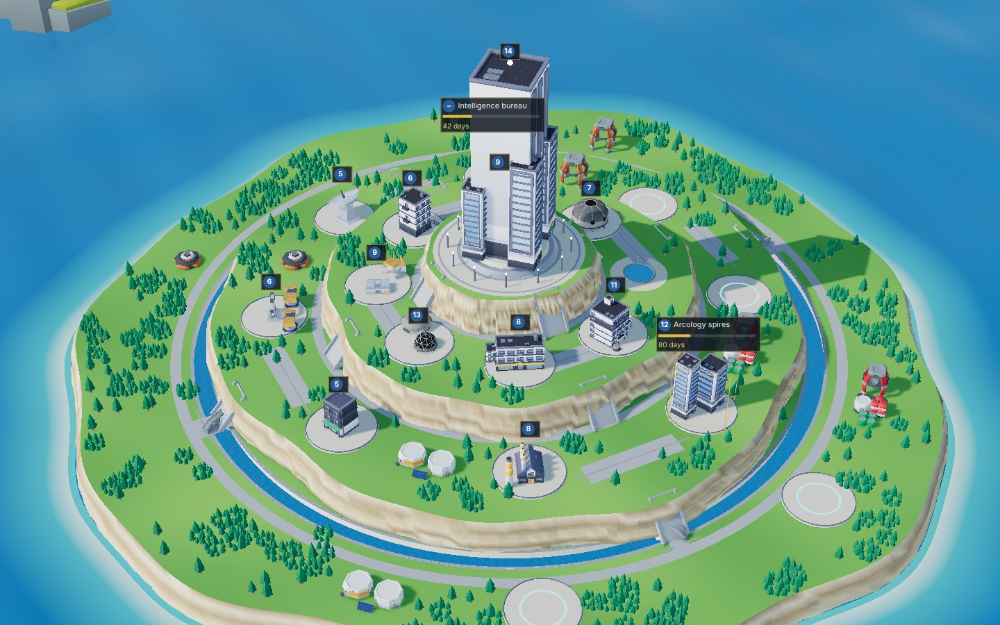 |  |
| **B · Mobile tier** |  | 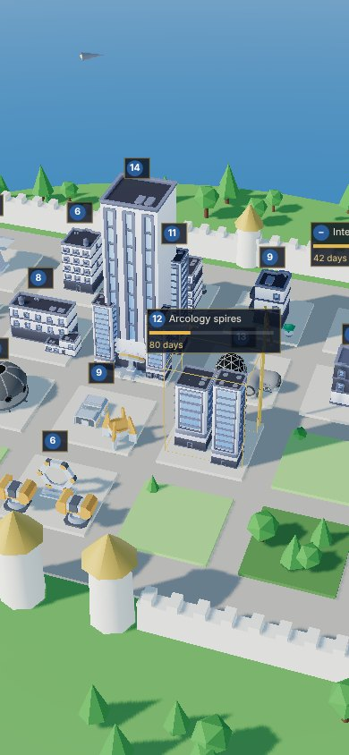 |

## What changed in C (the diorama)

- **Terrain:** an irregular raised island with four terraces at different heights: the Citadel plateau, then upper, middle and outer terraces. The cliff walls between them have layered rock strata and ledges, and the outer cliffs drop to a sandy waterline.
- **Water:**
  - the sea, with a procedural ripple normal map and sky reflections;
  - turquoise shallows and a foam line along the coast;
  - a stone-lined canal ringing the outer terrace.
- **Layout:**
  - **Plaza and Citadel:** a circular paved plaza with a stepped podium, where the Citadel stands as the tallest landmark.
  - **Avenues:** four radial avenues run from the plaza, with ramps down each cliff and bridges over the canal.
  - **Promenades:** ring promenades on each terrace.
  - **Memorial:** a reflecting-pool memorial in the one spare upper-terrace place.
- **Districts:** sci-fi dressing in the gaps between plots, from KayKit Space Base Bits:
  - **residential:** habitat modules and solar panels;
  - **industrial:** cargo depots, containers and drills;
  - **military:** landing pads and landers;
  - **research:** wind turbines and solar arrays.
- **Vegetation:** groves, single trees, rocks on the cliff lips, and water plants in the canal. Locked plots grow woodland, which clears when a plot opens.
- **Background:** distant mountain islets and low clouds.
- **Plots:** round paved pads with a metal rim. Empty open plots show a faint holographic ring.
- **What stays the same:** the building models are the existing catalogue parts, so they still grow by level tier. The grid of square plots is gone.

**Gameplay is preserved:**
- **Plot IDs:** the simulation's 24 plot IDs are kept. `dioramaLayout()` places them on terraces in unlock order (`PLOT_ORDER`), so unlocking still moves outward from the Citadel. No simulation code changed, so saves are unaffected.
- **Same interface:** `DioramaCapitalView3D` has the same interface as the production view (`sync`, `pick`, `plotScreen`, `dispose`). Selection, labels, construction scaffolding and the queue work the same way.
- **Tests:**
  - `tests/diorama-layout.test.ts` checks that every plot is placed once, the Citadel is central, unlock order only moves outward, and every pad lies on its terrace, clear of the avenues, the canal and the other pads.
  - `tests/e2e/capital-lab.spec.ts` checks that clicking a label or the 3D scene selects the right plot.

## Rendering pipeline (`src/ui/render/pipeline.ts`)

Used by B and C. It runs on the project's three.js r160.

| Part | Implementation |
|---|---|
| Composer | `EffectComposer` into a half-float (HDR) render target, with MSAA on desktop and medium, then `RenderPass`, `GTAOPass`, `UnrealBloomPass` and `OutputPass` |
| Ambient occlusion | `GTAOPass` for contact shading. Water and transparent overlays are left out of its depth pass; otherwise the flat sea meeting the cliffs reads as a deep crease and draws a dark ring round the coast |
| Environment | HDR `Sky` pre-filtered with `PMREMGenerator` into `scene.environment`, so PBR materials get matching reflections and ambient light. The visible sky is the same shader |
| Sun and fill | A `DirectionalLight` sun, from the front-left so shadows fall visibly to the right, plus a low `HemisphereLight` fill |
| Shadows | Orthographic shadow camera fitted to the scene bounds in light space. `normalBias` comes from the shadow-texel size and `bias` is small. Map size depends on the quality tier |
| Colour | ACES filmic tone mapping and sRGB output in `OutputPass`, from the renderer settings; exposure 0.82 |
| Bloom | Threshold 4.5 in linear HDR, above any sunlit surface, so only the emissive sci-fi lights bloom (plaza pylons and the Citadel beacon). Off on mobile |
| Not used | No depth of field, motion blur or film grain |

### Quality tiers

| Tier | Pixel ratio cap | MSAA | Shadow map | AO samples / denoise / resolution | Bloom | Vegetation |
|---|---|---|---|---|---|---|
| Desktop | 2 | 4× | 4096 | 16 / 16 / full | Yes | Full density; casts shadows and receives AO |
| Medium | 1.5 | 2× | 2048 | 12 / 8 / 75% | Yes | 75% density; casts shadows, no AO |
| Mobile | 1 | Off | 1024 (PCF) | 8 / 4 / 50% | No | 50% density, lighter tree models only, no shadows or AO |

`detectTier()` picks a tier from touch support, screen size, core count and device memory. The laboratory lets you override it.

## Performance

**Scene cost per frame**, at 390×844 and pixel ratio 1. These counters (`renderer.info`, summed over every pass of the frame: shadow map, AO normals, main view and post-processing) are exact.

PERF_COUNTERS

**What reduced the diorama's cost:**
- Repeated vegetation and rocks are `InstancedMesh`es split into four sector chunks with correct bounding spheres, so off-screen chunks are culled.
- Small static procedural meshes (ribbons, ramps, pylons, rings, pads) are merged into one mesh per material.
- The detail layer (rocks and water plants) is hidden beyond a per-tier camera distance.
- On mobile, vegetation is left out of the shadow and AO passes and uses only the lighter tree models.
- Together these brought the mobile tier from 1.23M to 0.43M triangles and from 875 to 393 draw calls.

**Frame times.** The only GPU available here is SwiftShader, a CPU software rasteriser in headless Chromium. Its timings show relative cost between variants. They are not device frame rates.

PERF_TIMES

**Not measured: real-device frame rates.** No Android phone or desktop GPU was available, so I can't claim the 30 FPS mobile and 60 FPS desktop targets are met. Open the live lab on the target devices (it shows FPS and the tier) and choose the default tier from what you see.

**Cleanup.** `RenderPipeline.dispose()` releases:
- the composer and its render targets;
- every pass;
- the PMREM environment and generator;
- the sky;
- the shadow map.

`DioramaCapitalView3D.dispose()` also frees its kit models, instanced meshes and generated textures, and keeps the shared model cache. The browser test checks that after disposal the renderer reports **0 geometries and 0 textures** for both B and C.

## Asset sources and licences

| Pack | Source | Licence | Used |
|---|---|---|---|
| KayKit Medieval Hexagon Pack 1.0, Kay Lousberg | https://github.com/KayKit-Game-Assets/KayKit-Medieval-Hexagon-Pack-1.0 (the creator's own public repository; `LICENSE.txt` states CC0) | CC0 1.0 | Environment only: grove and single trees, rocks, hills, mountains, clouds, water lily, reeds, stone bridge |
| KayKit Space Base Bits 1.0, Kay Lousberg | https://github.com/KayKit-Game-Assets/KayKit-Space-Base-Bits-1.0 (creator's repository, CC0 in `LICENSE.txt`) | CC0 1.0 | District dressing: habitat modules, cargo depots, containers, drill, landing pads, lander, solar panels, wind turbine, mast |

- **Totals:** the 32 models used come to **1.05 MB** of glTF and bin files. Each pack shares one **1024×1024** gradient-atlas PNG (16 KB and 26 KB). Models run from 18 to 1,540 triangles each.
- **Not used, deliberately:** the pack's hexagonal tiles (they would make the island look hex-tiled) and every medieval building, wall and unit.
- **For review:** the canal bridge is a stone arch from the medieval pack. Say whether it fits.
- **Cost:** IDR 0. Nothing was bought, and there are no subscriptions or restricted downloads.
- **Not yet in the repository:** the packs are fetched into `dev-assets/` for the laboratory. If you approve C, the chosen models would be converted to GLB, added under `public/assets/models/`, and listed in `ASSET_CATALOG.md`.

## Direction A: renewed search for character models

- **What I found:** a public CC0 repository that redistributes the Quaternius packs as OpenUSD files: `chibifire-stages/quaternius-stage`. It includes:
  - Universal Base Characters (base bodies, 37 MB);
  - Ultimate Modular Men and Ultimate Modular Women (realistic-proportion outfits, including a King, about 108 MB).
- **Why I didn't download it:** it's a third-party conversion rather than the creator's own release, and this session's safety policy blocked the download as a way around the itch.io restriction.
- **Your options:**
  - approve that mirror as a source;
  - download Universal Base Characters [Standard] from https://quaternius.itch.io/universal-base-characters in a browser and add it to the repository.

  Either way, Blender 4.2 is available here to convert the files to GLB for the Hall of Heroes.

## Known limitations

- **The Citadel** is still the existing Kenney skyscraper composition, scaled up on a podium. It dominates the skyline but isn't yet a distinctive monumental sci-fi landmark. No free model found so far is monumental enough; this is the main art gap left.
- **Labels** are drawn over the scene, as in production, so a plot directly behind the Citadel shows its label over the tower.
- **Mobile frame rate:** the mobile tier's 0.43M triangles per frame should suit mid-range phones, but this hasn't been measured on a device.
- **Visual regression baseline:** the screenshot baseline (`tests/e2e/capital-lab.spec.ts-snapshots/`) was made with headless Chromium on Linux and SwiftShader. Other platforms need their own baseline.

## Decision needed

1. Approve **C** (diorama) for production, approve **B** (new lighting on the current layout), or request changes. Examples: the camera (perspective or orthographic), the terrace heights, vegetation density, the bridge style, the Citadel treatment.
2. Choose the default quality tier per device class, after trying the live lab on your phone.
3. Choose how to get the Direction A character models, as described above.

## Variant D · Megacity (milestone 15, in the game behind a graphics setting)

`capitallab.html?variant=d` renders the sample capital as an imperial megacity. The same view is now the game's Capital screen (see *In the game* below). It is built only from sourced CC0 assets: the megacity kit, the Neon Town vehicles, a Quaternius shuttle and Poly Haven textures (`docs/ASSET_CATALOG.md` → *Capital megacity kit*).

| Medium tier | Close | Low horizon (skyline) | New game, low tier |
|---|---|---|---|
| 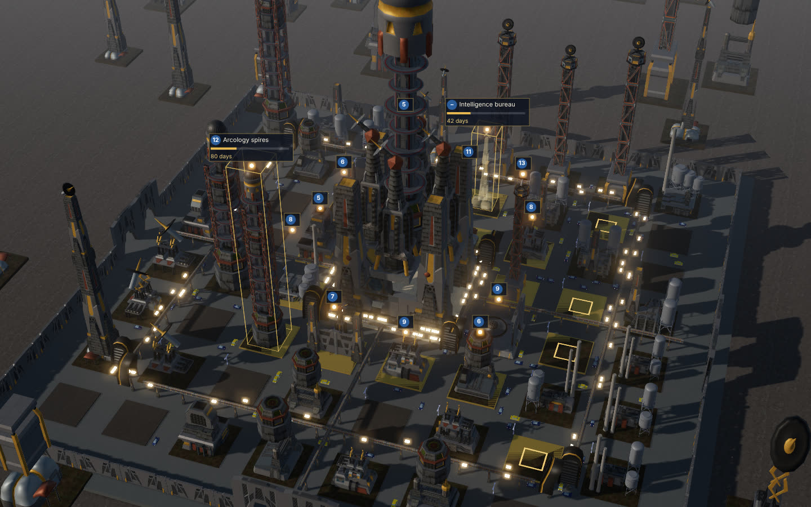 | 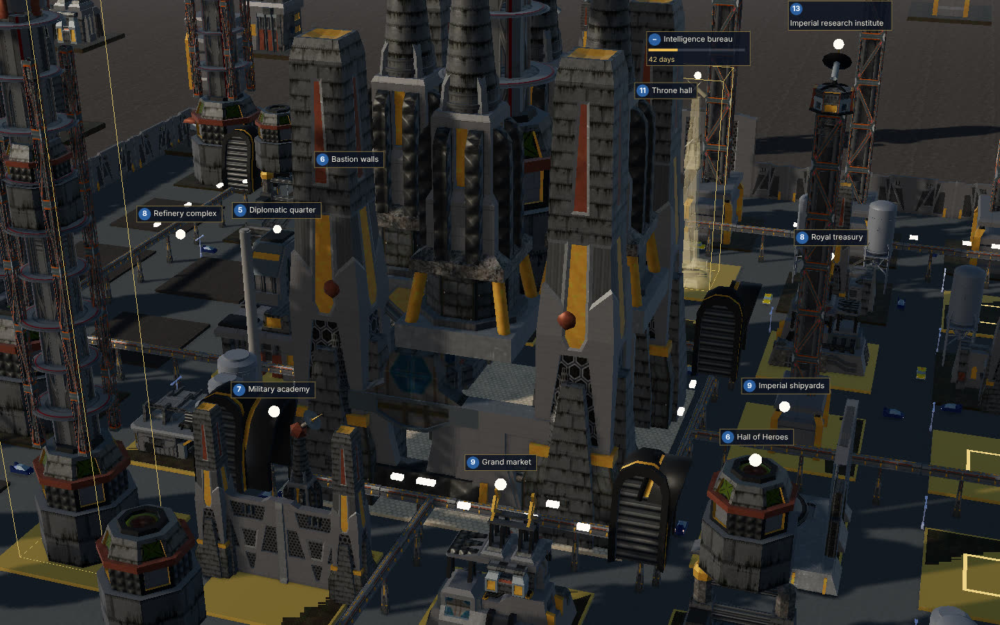 | 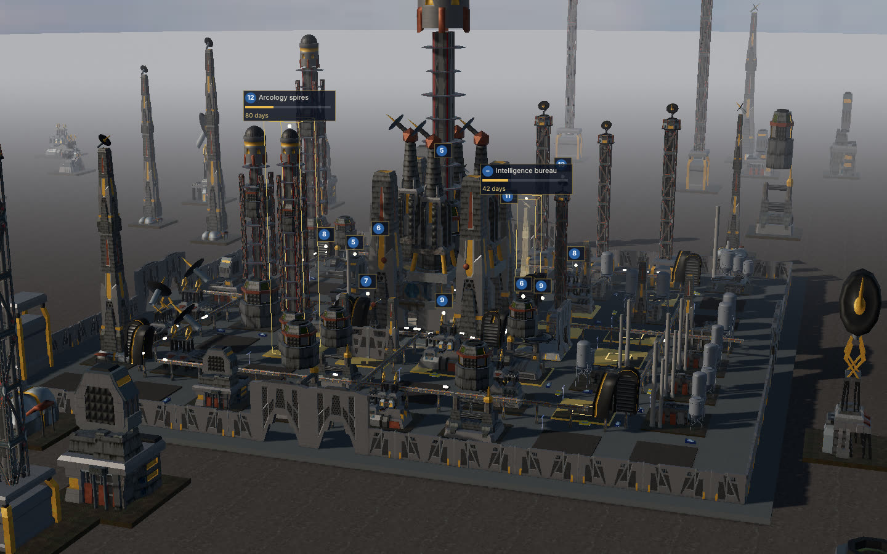 | 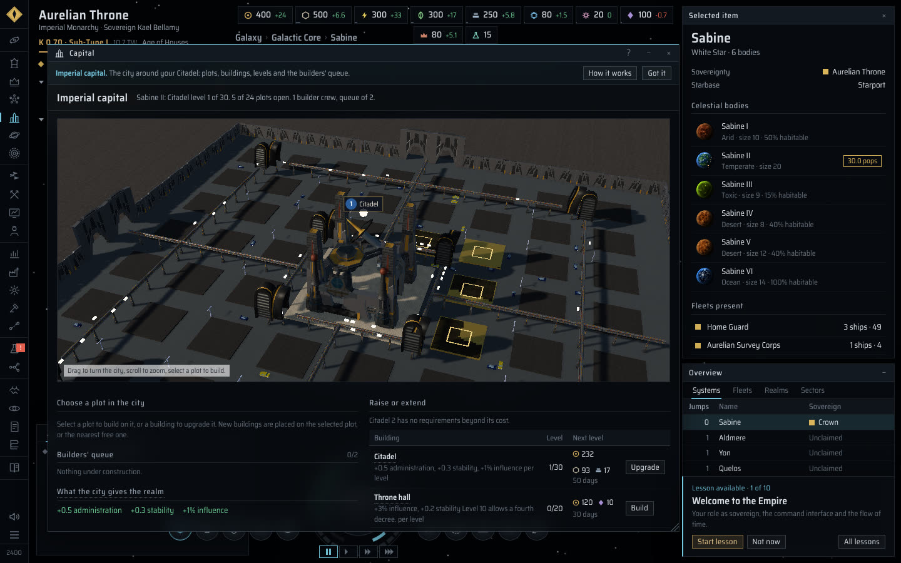 |

- **Layout** (`src/ui/render/megacityLayout.ts`, pure data and tested):
  - The Imperial Citadel stands on a central 2 × 2 block.
  - The 23 other plots fill ring 1, then ring 2, in the game's unlock order (`PLOT_ORDER`).
  - Every other block of rings 2 and 3 is a residential, industrial, energy or civic district, built as the Citadel rises.
  - Elevated transit tubes on pylons form two loops and four radials, with lights moving through them.
  - A perimeter wall has a gate on each axis.
  - Beyond the wall, up to 140 towers of the outer city stand on paved plinths. They keep the gate approaches clear and rise with the Citadel level (`skylineLayout`).
- **Surroundings:**
  - A photographed sky (Poly Haven, Kloppenheim 06) forms the horizon, turned so its sun matches the scene's light.
  - The same sky is pre-filtered into the environment light (`RenderPipeline.setSkyMap`).
  - Haze in the horizon's colour fades the outer city.
  - Avenues, lots, the plaza and the land use scanned Poly Haven textures with normal maps.
- **Traffic:**
  - Neon Town cars and taxis drive the six avenues, keeping to the right of each (`carAt`; tests check they never cross a plot or the Citadel plaza).
  - Quaternius shuttles circle the Citadel on three air lanes.
  - Both are instanced, so each vehicle type costs one draw call per material.
- **Buildings:**
  - Each capital building maps to a kit model per level tier (`MEGA_TIERS`) and grows 3% per level within a tier.
  - The Citadel passes through four stages (levels 1, 6, 12 and 20).
  - Sky-bridges link neighbouring towers that both rise above 24 units.
  - Labels, selection, scaffolding and construction ghosts behave as in the other views.
  - Plot ids are unchanged, no simulation code changed and saves are unaffected.
- **Camera:** a young capital is framed close up and a grown one whole, until the player turns or zooms it.

### In the game: the full-screen capital

The Capital is a view, not a window (`src/ui/screens/CapitalScene.tsx`, store `view: 'capital'`).

| New game | Developed capital | Building selected | Phone |
|---|---|---|---|
| 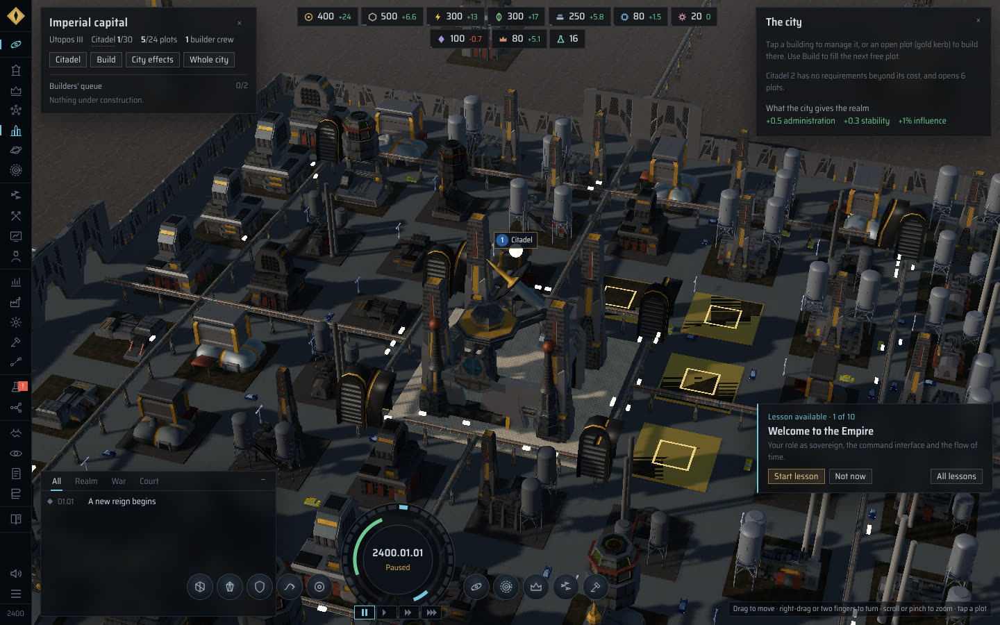 | 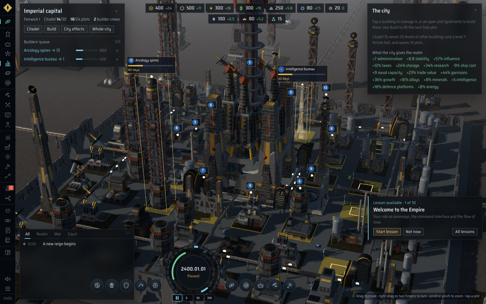 | 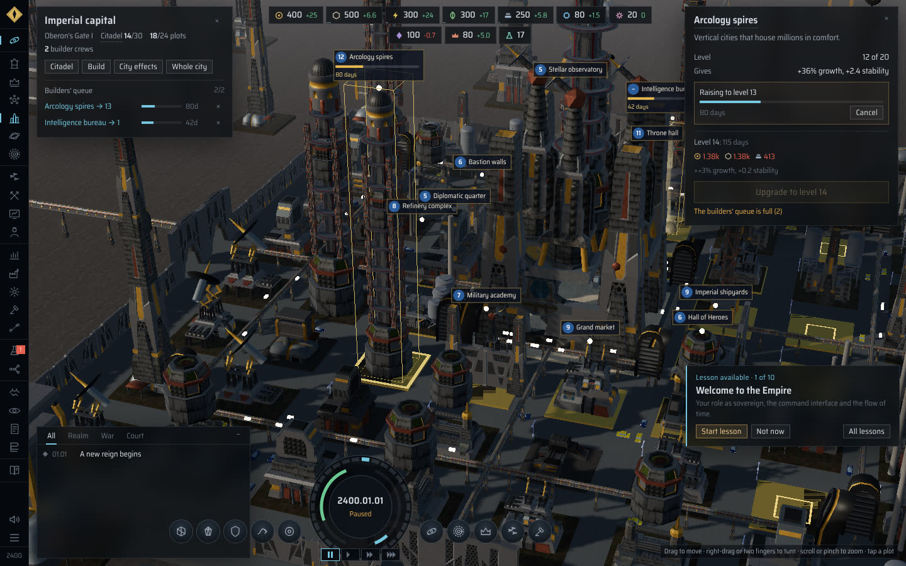 | 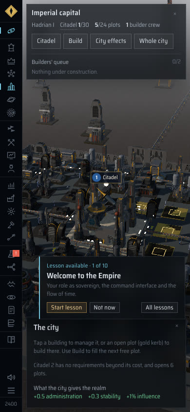 |

- **The city fills the viewport** beside the ministries column. The resource strip, throne dial, dispatches, guidance and neocom stay as HUD overlays. The galaxy map stops drawing underneath.
- **Title card** (top left): the world, Citadel level, open plots, builder crews, a toolbar (Citadel, Build, City effects, Whole city) and the builders' queue with progress and cancel.
- **Contextual panel** (right):
  - for a selected building: its level and effects, work in progress with Cancel, the next level's cost, time and effect, and Upgrade, with the reason when it is not possible;
  - for an open plot: a build list;
  - for a sealed plot: what opens it;
  - otherwise: the city's effects and the Citadel's next requirements.
- **Every control issues the simulation's own commands** (`capitalBuild`, `capitalCancel`). Plot ids, levels, queues and saves are unchanged.
- **Camera:** drag to pan, right-drag (or Shift, or a two-finger twist) to turn, wheel or pinch to zoom. Selecting a plot glides the camera to it.
- **Leaving:** Esc closes an open window first, then clears the selection, then returns to the galaxy. The neocom's Capital button and the title card's × also leave.
- **On phones** the title card spans the top and the panel is a bottom sheet that opens on selection. The throne dial, dispatches and resource strip are hidden while in the capital.
- **Density from the first day:**
  - district blocks always stand, as lower kit buildings until the Citadel reaches their level;
  - plots the Citadel has not opened carry an older, darker quarter, cleared when the plot opens;
  - more than half the outer skyline stands from the start;
  - transit tubes continue past each gate across the outer city.
- **Quality profiles** (`PROFILE` in `capitalMegacity.ts`):

| Tier | Skyline towers | Cars | Shuttles | Tube lights | Outer tubes reach | Ambient occlusion |
|---|---|---|---|---|---|---|
| Low (mobile) | 80 | 36 | 8 | 60 | 200 units | off |
| Medium | 150 | 90 | 18 | 120 | 260 units | on |
| High (desktop) | 200 | 120 | 24 | 160 | 300 units | on |

- **Frame-rate readout:** Chancery → Graphics → *Show frame rate and draw calls in the capital*. Use it to measure on real hardware; no GPU was available while building this.
- `tests/e2e/capital.spec.ts` checks:
  - the viewport coverage;
  - building on the next free plot through the panel, the queue, cancel and the Citadel upgrade;
  - Esc order;
  - the phone bottom sheet.

### Graphics settings

- `CityCanvas` (`src/ui/screens/Capital.tsx`) picks the view from the graphics settings (`src/ui/graphics.ts`).
- The setting is under Chancery → Graphics and Codex → Settings → Graphics, and is stored in this browser as `sd.graphics.v1`.
- **Capital city** setting:
  - *Automatic* (the default) draws the megacity, unless the browser renders WebGL in software (SwiftShader, llvmpipe), where it would crawl; then it draws the classic city.
  - *Imperial megacity* or *Classic city* force either view.
- **Megacity quality** setting:
  - *Automatic* uses the low (mobile) tier on touch devices, windows narrower than 900 px and machines with 4 cores or fewer, and medium elsewhere.
  - The high (desktop) tier is opt-in.
- Changing either setting rebuilds the view on a fresh canvas.
- `tests/e2e/megacity.spec.ts` checks the software fallback, label picking in the megacity and switching back to the classic city. `tests/graphics.test.ts` checks the setting logic.

### Performance (SwiftShader, so not device frame rates)

| Scene | Tier | Draw calls | Triangles per frame (all passes) |
|---|---|---|---|
| Sample capital (14 buildings, Citadel 14) | low | 711 | 1.8 M |
| Sample capital | medium | 726 | 2.1 M |
| New game (Citadel 1) | low | 221 | 0.89 M |

- Scene triangles for the sample capital at the low tier:
  - infrastructure 195 k;
  - districts 117 k;
  - outer skyline 112 k;
  - buildings 70 k;
  - vehicles 22 k.
- The shadow and AO passes roughly triple the per-frame triangle count. The skyline and vehicles cast no shadows.
- On SwiftShader a frame takes about one second, which is why *Automatic* chooses the classic city there.
- The desktop tier has not been measured on a GPU.

### Known gaps

- Pedestrians are not modelled; at the city's scale they would be under a pixel.
- Cars pass through one another at crossings (there are no traffic signals).
- The transit tubes put a pylon under every 6-unit section. Thinning them out would need a pylon-free section in the kit.

## Milestone 16: streets, people, metro, planetary setting and city activity

Everything below is drawn with sourced CC0 models (tevy.dev and Kenney City Kit Roads; see `docs/ASSET_CATALOG.md`). Code supplies placement, instancing and animation only.

| Avenue | Intersection | Market square |
|---|---|---|
| 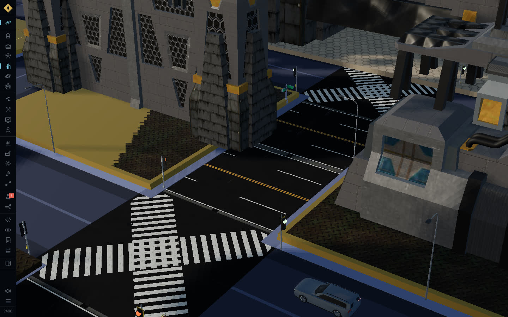 | 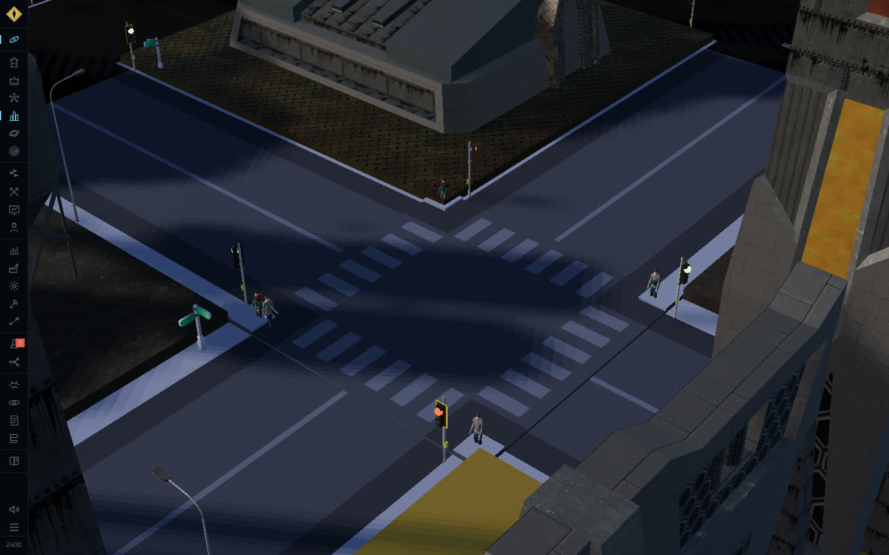 | 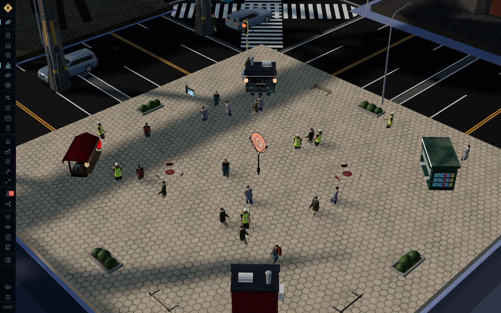 |

| Metro station | Port logistics | Planetary horizon |
|---|---|---|
| 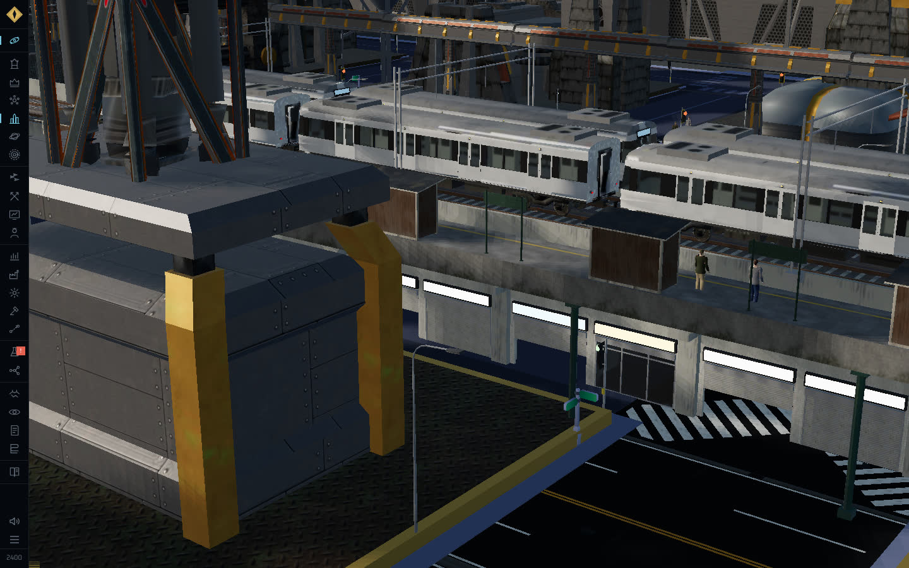 | 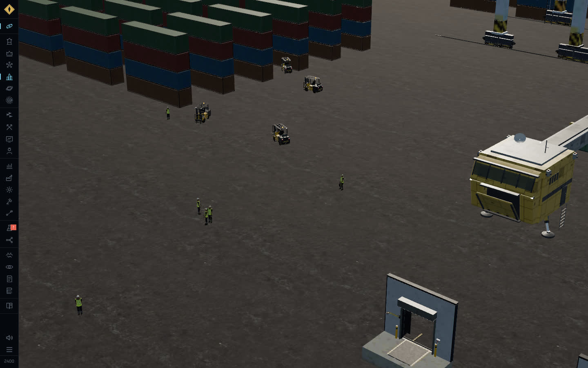 | 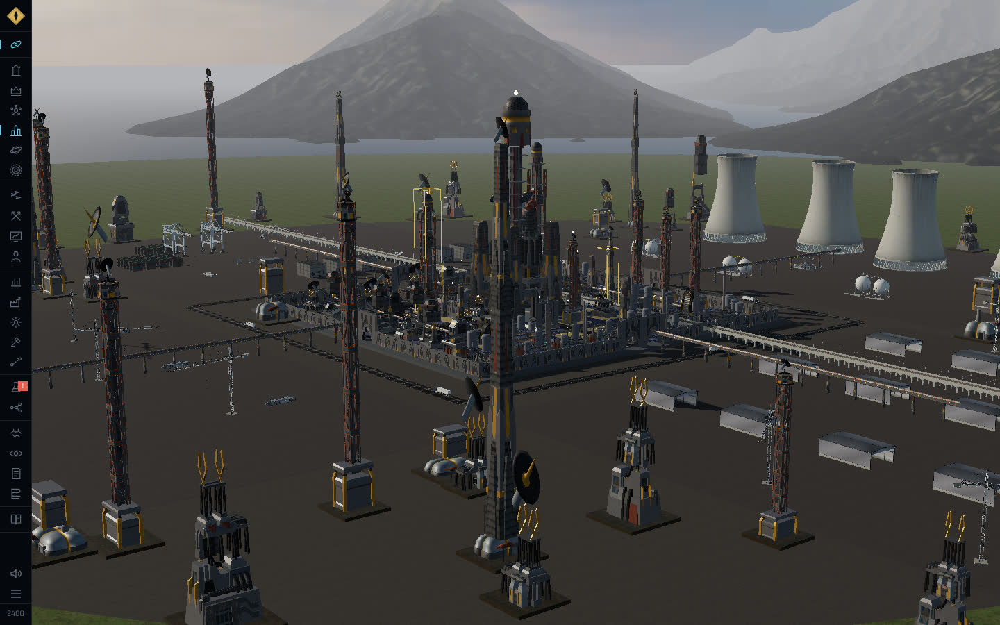 |

| New game, low tier | Developed capital, medium tier | Freighter at the dock |
|---|---|---|
| 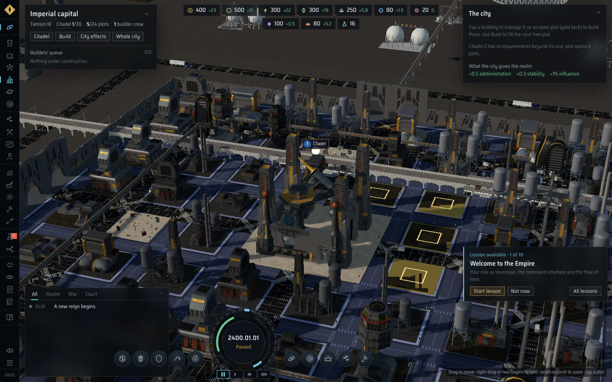 | 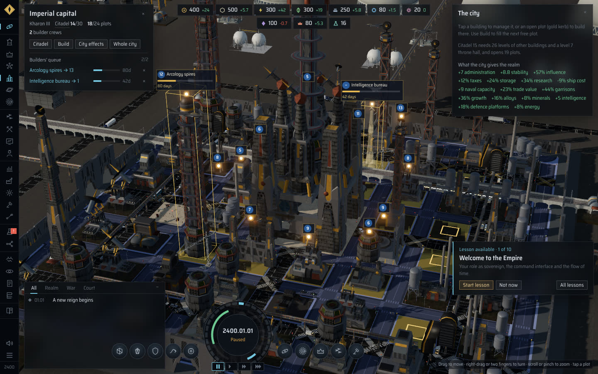 | 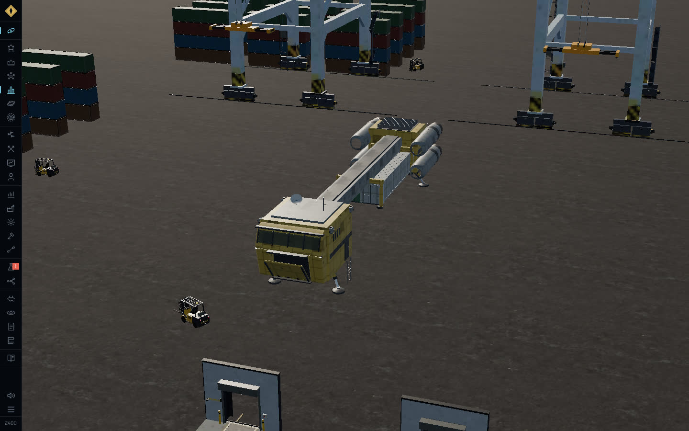 |

### Streets and traffic (`cityRoads.ts`, drawn by `capitalLife.ts`)

- **Road network:** a graph on the megacity grid.
  - **Avenues:** the ceremonial axes and the ring road, using tevy's four-lane road and scramble junction, with Kenney paving for sidewalks.
  - **Local streets:** Kenney straight, crossroad, T-junction and bend tiles, with crosswalks, kerbs and sidewalks.
  - None of the streets cross the Citadel plaza.
- **Signals:** a tevy traffic light stands on the near-right corner of each approach to a junction where three or more streets meet. Its lamp shows the live phase. Each junction's cycle is offset from its neighbours'. Crossing streets never share a green.
- **Street furniture:** tevy street lamps and bus shelters (the buses run between the shelters), and Kenney street signs.
- **Vehicles:**
  - Models: tevy estate cars, taxis, hover cars, cargo vans, buses, police cars and ambulances.
  - Each picks destinations that make sense for its kind:
    - vans: industry, the gates and building sites;
    - cars and taxis: homes, the civic blocks and the plots;
    - buses: their stops;
    - police and ambulances: anywhere.
  - Routes are found by Dijkstra.
  - Traffic drives on the right, in lanes, and follows curves through junctions.
  - A vehicle decides once whether to stop when a light turns amber, as drivers do.
  - Vehicles keep a braking-distance gap and reserve the exit lane before turning.
  - On arrival a vehicle pulls into the building, then sets off for its next destination.
- `tests/city-roads.test.ts` (two simulated minutes) checks connectivity, routes, signal phases, that vehicles stay in their lanes and never run a red, bumper gaps and arrivals.

### People

- **Models:** tevy's rigged people (shared skeleton, `walk` and `idle` clips).
- **Rendering:** near the camera (up to 12 at medium and 24 at high) they are skinned meshes playing their clips. Further away they are instanced copies of eight walk-cycle poses and one idle pose, baked from the same models.
- **Sidewalks:** walkers go corner to corner and cross only on crosswalks while the walk signal is lit.
- **Market squares:** two inner blocks hold tevy kiosks, a food cart, holographic signs, planters, benches and bistro sets. Their crowds stroll, gather at the stalls and idle; they never walk through furniture or leave the square (tested).
- **Work crews (hi-vis):** they circle every building under construction (from the capital's queue) and stand on the spaceport, shipyard and industry aprons.
- **Metro passengers:** they wait on the platforms, walk to the open doors and board; others step off and walk away.

### Metro (`metro.ts`, `capitalMetro.ts`)

- **Line:** a double-track tevy viaduct with catenary along z = -32, across the city and the outer city. The piers stand clear of the junctions. The stations use the span with shops underneath.
- **Stations:** platforms on columns, with benches and street-level entrance canopies.
- **Trains:** three tevy metro cars each. A train slows to a stop, slides its eight platform-side door leaves open, boards for seven seconds, closes and departs. Beyond the outer city it crosses over and returns.
- **Tests:** `tests/metro.test.ts` checks the stops, that doors open only while stopped, and the turnbacks. The browser test checks that eight door leaves have moved while the far side stays shut.
- **Elevated tubes:** the sealed expressway ring over the ring road carries no traffic markers. It is no longer presented as transit.

### Planetary setting (`capitalWorld.ts`)

- **Outer ring:** four paved districts on the gate axes:
  - energy (cooling towers, tank farms, substations);
  - industry (factory halls, container yards, tower cranes);
  - spaceport (hangars, control tower, harbour cranes, container yards, parked shuttles and dropships, loading docks);
  - shipyard (dropships on slips under cranes, hangars).
- **Cargo road:** a ring road linking the districts, with semi-trucks on it.
- **Landscape, by the capital world's type:**
  - snow-capped peaks and ridges on temperate, ocean, jungle, tundra and frozen worlds;
  - sandstone buttes on desert and arid worlds;
  - cliff ranges on volcanic, toxic and barren worlds.
  - Beyond the urban ring the ground uses tevy's matching material: meadow, desert sand, snow or granite.
- **Coast:** worlds with a sea put the capital on an island.

### Activity driven by the realm (`capitalActivity.ts`)

- **Freighter:** it descends to the dock, puts its legs down and lowers its ramp. Its four containers roll down to forklifts, which carry them to the yard. Then it raises the ramp and leaves. It calls more often as the realm's industry grows.
- **Fighters:** the number on patrol follows naval readiness (ships in service against capacity), with more of them, flying faster, at war. In turn each comes home: it lands with its gear down and taxis into a hangar, whose blast door rises. Later it rolls out and takes off again.
- **Drones:** swarms travel between the industrial district and each capital building under construction, and circle the site.
- **Cranes:** a tower crane stands beside each building under construction, slewing and working its hook.

### Performance (SwiftShader, which is a CPU renderer; no GPU was available)

| View | Tier | Draw calls | Triangles per frame (all passes) |
|---|---|---|---|
| New game, default view | low | 940 | 3.1 M |
| Developed capital, default view | medium | 1,955 | 6.1 M |
| Market square close-up | medium | 1,127 | 5.5 M |

- **Low tier settings:**
  - no ambient occlusion;
  - fewer vehicles (38) and people (about 90 including the squares);
  - one signal pole per junction axis;
  - the viaduct drawn only to ±200;
  - no furniture shadows.
- **Medium tier:** also skips ambient occlusion.
- **All tiers:**
  - static sets are bounded and culled off screen;
  - nothing beyond the walls casts shadows;
  - hidden drones are not drawn.
- **Real hardware:** turn on *Show frame rate and draw calls in the capital* (Chancery → Graphics) to measure on a real GPU. The figures above are not frame rates.

### Known gaps

- **Pedestrians and turning vehicles:** pedestrians cross while the crossing street's traffic is red, but a vehicle turning from the parallel street can drive through a crosswalk while people are on it. There is no yielding model yet.
- **Rendering:** vehicle wheels do not turn, and drone rotors do not spin (the sets are instanced).
- **Port scale:** at true scale the spaceport and industry districts are sparser than the city. The port is busiest round the dock.
- **Unused models:** the high-speed train, walk signals and signal masts were fetched but are not used.
- **Kenney Train Kit:** not evaluated, because kenney.nl refused automated downloads.
